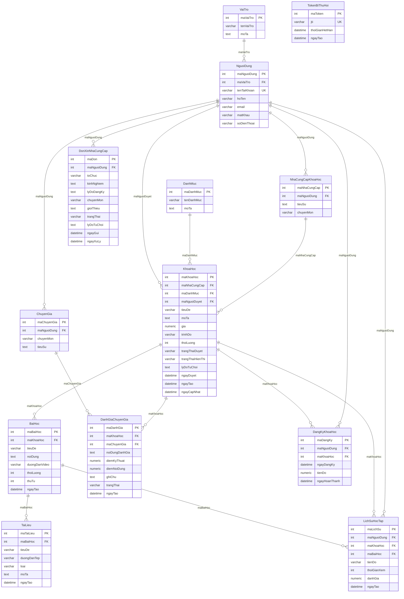

# EduSuggest database ERD

This diagram documents the existing 11 ERD tables, the previously added JWT
revocation table, and the additive `DonXinNhaCungCap` table. The `NguoiDung`
table now has an additive `tenTaiKhoan` column for username-based sign-in;
the existing primary/foreign keys and other ERD tables are unchanged.

`KhoaHoc.trangThaiDuyet` and `KhoaHoc.trangThaiHienThi` remain separate:
EXPERT controls review (`PENDING`, `APPROVED`, `REJECTED`, `NEEDS_REVISION`),
while ADMIN may set visibility (`VISIBLE`, `HIDDEN`) only after approval.
`DonXinNhaCungCap.trangThai` uses `PENDING`, `APPROVED`, and `REJECTED`.
