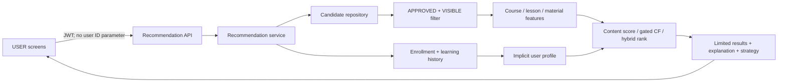

# EduSuggest Recommendation System — Design Analysis (Giai đoạn 8.1)

**Trạng thái:** thiết kế đề xuất; chưa triển khai thuật toán/API/UI.  
**Căn cứ:** source hiện tại, ERD, migration/model và truy vấn PostgreSQL chỉ đọc ngày 2026-11-24. Không tạo hoặc sửa dữ liệu, schema, migration hay cấu hình.

## 1. Kiến trúc hiện tại và ranh giới đề xuất

Backend hiện theo luồng FastAPI router → service → repository → SQLAlchemy/PostgreSQL. Recommendation nên là một service/backend capability mới dùng lại các model và truy vấn catalog hiện có; không tạo bảng `GoiY` hoặc `DuLieuTuongTac`. Giai đoạn đầu có thể tính điểm tại request, chỉ cần xem xét cache khi có catalog đủ lớn và đo được chi phí truy vấn.



The authenticated principal is the source of `user_id`. Clients must not choose a user whose preference or history is queried. All recommendation candidates must follow existing USER visibility rules. Material recommendations must not bypass the Phase 7 enrollment gate for lesson content or documents.

## 2. Dữ liệu hiện có

| Nguồn | Trường dùng được theo model | Phân loại và giới hạn |
|---|---|---|
| `KhoaHoc` | `tieuDe`, `moTa`, `maDanhMuc`, `gia`, `trinhDo`, `thoiLuong`, `trangThaiDuyet`, `trangThaiHienThi`, timestamps | Metadata item đã có trong model/API; không có mục tiêu học tập, tags, keyword, ngôn ngữ, audience hoặc rating của learner. `maDanhMuc` và nhiều trường nullable. Chỉ lấy APPROVED + VISIBLE. |
| `DanhMuc` | `tenDanhMuc`, `moTa` | Có thể làm đặc trưng nhóm/chủ đề; danh mục hiện không có phân cấp hoặc synonym. |
| `BaiHoc` | `tieuDe`, `noiDung`, `duongDanVideo`, `thoiLuong`, `thuTu`, `maKhoaHoc` | Có thể làm giàu nội dung khóa học; `noiDung` là text tự do, không có tags/learning outcomes. |
| `TaiLieu` | `tieuDe`, `moTa`, `loai`, `duongDanTep`, `maBaiHoc` | Quan hệ: Tài liệu → Bài học → Khóa học → Danh mục. Không có keyword, MIME/size đáng tin cậy, trạng thái kiểm duyệt riêng, giấy phép, ngôn ngữ hoặc rating. Đường dẫn không tự chứng minh file còn tồn tại hay được phép public. |
| `DangKyKhoaHoc` | user, course, `ngayDangKy`, `tienDo`, `ngayHoanThanh` | Implicit positive signal cho course interest. Không có trạng thái hủy, nguồn đăng ký, impression/click hoặc constraint duy nhất user-course trong model hiện tại. |
| `LichSuHocTap` | user, course, lesson, `tienDo`, `thoiGianXem`, `danhGia`, `ngayTao` | Có thể dùng completion/progress khi trạng thái được chuẩn hóa. Ý nghĩa/đơn vị `thoiGianXem` và ý nghĩa `danhGia` chưa được xác nhận bằng schema nghiệp vụ/UI. Không coi là learner rating nếu chưa xác minh. Không có impression, skip, search/click hoặc event taxonomy. |
| `DanhGiaChuyenGia` | course, expert, nội dung và điểm kỹ thuật/nội dung, trạng thái | Đây là nhận xét/điểm kiểm duyệt của EXPERT, không phải đánh giá sở thích của USER; không dùng như learner preference trong CF. |
| `NguoiDung` | username, tên, email, phone, role | Không có sở thích, mục tiêu, kỹ năng, ngân sách, lịch học hoặc lựa chọn danh mục. Không dùng email/tên/phone để suy diễn sở thích. |

### Dữ liệu PostgreSQL hiện tại (đếm tổng hợp, transaction READ ONLY)

Kết nối Backend được xác nhận vào `EduSuggest` trên PostgreSQL; không đọc dữ liệu định danh cá nhân. Kết quả hiện tại: **0 khóa học**, trong đó 0 APPROVED + VISIBLE; **0 bài học; 0 tài liệu; 0 danh mục; 0 đăng ký; 0 lịch sử học tập; 0 đánh giá chuyên gia; 3 tài khoản người dùng**. Vì vậy database hiện không có candidate catalog hay interaction để tạo/đánh giá recommendation. Đây là snapshot lúc kiểm tra, không phải khẳng định dữ liệu sẽ luôn rỗng.

**Phân loại:** model/quan hệ nêu trên đã tồn tại; API quản lý/đọc một số dữ liệu đã có; dữ liệu nghiệp vụ Recommendation thực tế hiện không có; sở thích explicit, impression/click/skip và learner course rating chưa có trong model/API. Dữ liệu fixture/demo trong Frontend không được xem là dữ liệu thật.

## 3. API và Frontend đang có

### Backend

- USER catalog: `GET /api/categories`, `GET /api/courses` (title query, category ID, `limit` tối đa 100), `GET /api/courses/{course_id}`. Kết quả lọc APPROVED + VISIBLE; course detail không trả danh sách lesson khi USER chưa đăng ký.
- Học tập: `POST /api/courses/{course_id}/enrollments`, `GET /api/enrollments`, `GET /api/learning/courses/{course_id}`, `GET /api/learning/courses/{course_id}/progress`, `POST /api/learning/courses/{course_id}/lessons/{lesson_id}/complete`, `GET /api/learning/history` (được thêm ở Giai đoạn 7). Đây là nguồn implicit interaction tương lai; hiện bảng DB tương ứng rỗng.
- PROVIDER có các route sở hữu course, lesson và metadata tài liệu; EXPERT có review workflow. Không có endpoint USER trả recommendation, similar-course ranking, material catalog công khai hay learner course rating.
- Không thấy recommender repository/service/schema/router trong Backend. Tìm kiếm routes hiện tại không có endpoint recommendation.

### Frontend

- `/recommendations/courses` và `/recommendations/materials` dùng `getRecommendedCourses()` / `getRecommendedMaterials()` trong legacy `userService.js`; hai hàm trả mảng rỗng, không gọi API.
- `UserHome.vue` lấy catalog thật qua `fetchUserCourses`, nhưng vùng “Khóa học dành cho bạn” vẫn là trạng thái API chưa hỗ trợ.
- `Recommendations.vue` dùng empty state nói rõ chưa có dịch vụ Backend; chưa tích hợp recommendation API.
- `userData.js` khai báo `demoRecommendations` nhưng tìm kiếm tham chiếu chỉ thấy định nghĩa này; không dùng nó làm kết quả hiện tại.
- `adminData.js` có fixture `recommendationMetrics` với số tổng hợp minh họa và legacy `adminService.js` trả metric đó. Màn `AdminRecommendations.vue` hiện không import metric này và nói rõ chưa có API/số liệu. Không coi fixture là telemetry.

## 4. Content-Based Filtering

### Đặc trưng item

Tạo document text cho mỗi khóa học từ các trường thật, ưu tiên tách trường trước khi ghép: tiêu đề, mô tả, tên/mô tả danh mục, tiêu đề/nội dung bài học và tiêu đề/mô tả/loại tài liệu. Chuẩn hóa whitespace, HTML/URL và chữ hoa-thường; xử lý tiếng Việt có dấu nhất quán. Không lấy ID, đường dẫn file, tên provider hoặc trường moderation làm từ khóa sở thích. Trường thiếu được bỏ qua và trọng số còn lại được chuẩn hóa lại, không bị tính như mức tương đồng bằng 0.

Có thể bắt đầu bằng TF-IDF cosine trên văn bản (word/character n-gram để giảm phụ thuộc tokenizer tiếng Việt), cộng đặc trưng có cấu trúc: danh mục, trình độ, học phí và thời lượng. `scikit-learn`/vector search chưa có trong `backend/requirements.txt`; chọn thư viện và chi phí triển khai phải được xem xét ở bước coding, không tự thêm dependency ở giai đoạn phân tích.

### Hồ sơ người dùng và công thức khởi đầu

Chưa có hồ sơ sở thích explicit. Hồ sơ implicit chỉ có thể tạo sau khi có đăng ký/tiến độ thật: gom vector của các course user đã đăng ký; tăng trọng số cho course có tiến độ/hoàn thành cao; giảm trọng số theo độ cũ nếu timestamps đủ tin cậy. Không coi việc chưa đăng ký là tín hiệu dislike vì không có impression/skip. Không dùng `LichSuHocTap.danhGia` hoặc `thoiGianXem` cho tới khi xác nhận semantics, đơn vị và nguồn ghi.

Một công thức baseline **giả thuyết để offline-tune, không phải trọng số đã chứng minh**:

```text
text(c) = weighted-TF-IDF(title, description, category, lesson text, material metadata)
CB(u,c) = 0.60 * cosine(profile_text(u), text(c))
        + 0.20 * category_match(u,c)
        + 0.08 * level_match(u,c)
        + 0.06 * duration_match(u,c)
        + 0.06 * price_match(u,c)
```

`category_match`/`level_match` có thể lấy tần suất trong course đã đăng ký, chuẩn hóa thành phân phối; duration/price similarity chỉ dùng khi có đủ lịch sử và trường nguồn không null. Khi feature không có thì bỏ term và chuẩn hóa lại tổng trọng số. Trước khi có signal, `profile_text(u)` không tồn tại: trả danh sách rỗng hoặc fallback khám phá chung được gắn nhãn không cá nhân hóa, không bịa sở thích.

Sắp xếp điểm giảm dần, tie-break ổn định theo course ID; lọc trước candidate APPROVED + VISIBLE; loại course user đã đăng ký; loại trùng; giới hạn mặc định 10, tối đa đề xuất 20; không trả course ẩn/chưa duyệt để làm fallback. “Khóa học tương tự” có thể tính cosine giữa source course và candidate course, loại chính nó, dùng cùng trạng thái công khai.

## 5. Collaborative Filtering và Hybrid

### Khả thi hiện tại

Không đủ dữ liệu: DB hiện có 0 enrollment và 0 learning-history row, do đó User-Based, Item-Based, matrix factorization và hybrid không thể huấn luyện/đánh giá. Không triển khai CF trong Giai đoạn 8.1. Sau khi event có thật, item-item implicit cosine là baseline dễ giải thích hơn user-user ở catalog nhỏ; user-user thường càng thưa khi ít người dùng chung item. ALS/latent factor chỉ đáng cân nhắc sau khi lưu lượng, độ phủ và workload đo thực tế biện minh.

Enrollment là positive implicit event; lesson completion là tín hiệu sâu hơn. `DangKyKhoaHoc.tienDo` là aggregate, không phải event độc lập; tránh cộng đồng thời enrollment + progress + completion như ba hành vi độc lập nếu chúng mô tả cùng một chuỗi học. Không có negative event. `DanhGiaChuyenGia` là chuyên môn, không phải rating của learner.

### Điều kiện CF trước production

Đặt ngưỡng dữ liệu theo phân tích độ phủ/sparsity trên dữ liệu thật thay vì chọn ngưỡng tùy ý: đủ số user và item có interaction; đủ lịch sử theo thời gian để tạo train/holdout; có baseline vượt popularity/content baseline ở các metric mục tiêu; đo riêng tỷ lệ user/item cold-start; bảo vệ dữ liệu user và giới hạn query. Chưa thể định lượng ngưỡng vì hiện các tập interactions đều rỗng.

### Hybrid đề xuất

```text
H(u,c) = alpha * CB(u,c) + (1-alpha) * CF(u,c)
```

Khi CF chưa đạt data gate hoặc user/item không có neighbor đủ tin cậy: `alpha = 1` và chạy Content-Based; user chưa có profile thì trả fallback khám phá chung với `personalized=false` hoặc rỗng. Khi CF vượt gate, thử các `alpha` trên time-based validation; không chốt trọng số cố định bằng cảm tính. Chuẩn hóa score của hai nhánh trước khi blend; giữ hard filter APPROVED + VISIBLE và loại course đã đăng ký sau mọi bước ranking.

**Cold-start:** course mới dùng metadata Content-Based; user mới không thể cá nhân hóa từ dữ liệu hiện có. Không có cột sở thích để hỏi và lưu lựa chọn; nếu cần onboarding preference lâu dài, đó là yêu cầu bổ sung model/API cần phê duyệt riêng. Fallback popularity chỉ dùng số enrollment thật, có ngưỡng đủ mẫu và phải gắn nhãn không cá nhân hóa; hiện DB rỗng nên fallback đó cũng không khả dụng.

## 6. Gợi ý tài liệu

Candidate `TaiLieu` phải liên hệ qua `BaiHoc.maKhoaHoc`; đặc trưng hiện có gồm tiêu đề, mô tả, `loai`, tiêu đề/nội dung bài học và category/course text. Tính `D(material, context)` bằng text cosine; có thể cộng điểm tương ứng với lesson/context hoặc category đã xác thực. Không giả định có tags, keyword, MIME, dung lượng, license, ngôn ngữ hay điểm chất lượng. Không tạo quan hệ trực tiếp mới giữa tài liệu và khóa học: quan hệ hiện có đã đi qua bài học.

Gợi ý cho `course_id` cần xác thực course public và user đã đăng ký nếu response chứa material metadata/link/nội dung, bám theo enrollment gate Giai đoạn 7. Không cho recommendation endpoint làm lối tắt tải file. Chỉ trả resource có course APPROVED + VISIBLE; quyền truy cập file phải dùng luồng được bảo vệ/đã có, không coi `duongDanTep` là URL an toàn. Nếu sau này cần gợi ý tài liệu ngoài các khóa user đã đăng ký, phải thiết kế rõ metadata nào được hiển thị trước enrollment và không tiết lộ nội dung/private link.

## 7. API đề xuất (chưa triển khai)

| Endpoint đề xuất | Mục đích | Quyền / bộ lọc |
|---|---|---|
| `GET /api/recommendations/courses?limit=10&category_id=...` | Gợi ý cá nhân hóa; envelope có `items`, `strategy`, `personalized`, và reason code ngắn | `USER`; user từ JWT; candidate public; loại course đã đăng ký; limit 1–20 |
| `GET /api/courses/{course_id}/similar?limit=10` | Course tương tự theo item content | `USER`; source và candidate đều APPROVED + VISIBLE; loại source course; limit 1–20 |
| `GET /api/recommendations/materials?course_id=...&lesson_id=...&limit=10` | Tài liệu liên quan context học tập | `USER`; enrollment của current user cho course; lesson nếu truyền phải thuộc course; tài liệu theo lesson→course; limit 1–20 |

Response nên dùng schema riêng như `RecommendationListResponse`/`RecommendedCourse`/`RecommendedMaterial`, chỉ trả dữ liệu cần render, reason codes dựa trên feature thực sự đóng góp, không trả user ID/feature vector hay thông tin provider nội bộ. Nếu chưa có dữ liệu đủ để cá nhân hóa, trả empty list hoặc fallback có `personalized=false` và `strategy` rõ; không phát sinh dữ liệu giả. API chưa cần endpoint riêng cho lịch sử/impression trong bản đầu, nhưng CF/evaluation không thể được đo nếu không có event logging và chính sách consent/retention phù hợp. Không thay contract hiện có ở giai đoạn này.

## 8. Tích hợp Frontend đề xuất (không đổi UI ở giai đoạn này)

- `UserHome.vue`: thay placeholder “Khóa học dành cho bạn” bằng API recommendation sau khi endpoint có thật; giữ catalog `fetchUserCourses` độc lập.
- `Recommendations.vue`: chọn course/material endpoint theo route hiện hữu; thêm loading/error/retry/empty và nhãn “khám phá chung” khi không personalized.
- `CourseDetail.vue`: vị trí “Khóa học tương tự” dưới chi tiết; không hiển thị nội dung khóa khác chưa đăng ký.
- `LearningView.vue`: gợi ý tài liệu theo bài đang học hoặc khóa đã đăng ký; link mở phải giữ quyền truy cập hiện tại.
- Dùng centralized `userApiService`; request không gửi user ID; không lấy kết quả từ `userData.js`, `demoRecommendations` hoặc `adminData.recommendationMetrics`.
- `AdminRecommendations.vue` hiện là trạng thái chưa có API; không đưa fixture metric cũ lên UI như số liệu hệ thống.

## 9. Chiến lược kiểm thử và đánh giá

### Có thể kiểm tra ngay (không đo chất lượng Recommendation)

- Unit tests sau khi triển khai: trạng thái public filter, loại course đã đăng ký, limit, dedup, xử lý null/empty field, deterministic ranking, material→lesson→course joins, user từ JWT và không truy vấn theo ID client.
- Contract/authorization integration tests trên DB riêng: anonymous/non-USER, user khác, hidden/unapproved course, enrollment gate, hidden material, giới hạn result và trường hợp catalog rỗng.
- Các kiểm tra này chưa chạy trong thiết kế hiện tại; PostgreSQL đang có catalog rỗng nên các luồng có candidate chưa thể nghiệm thu.

### Chỉ tính được khi có interaction thật

- Time-based holdout: train trên event trước thời điểm T, đánh giá course user tương tác sau T; không random-split làm rò rỉ tương lai.
- `Precision@K`/`Recall@K`: cần ground-truth relevant items trong holdout; hiện 0 interaction nên **không tính được**.
- `NDCG@K`: cần ranking và relevance/graded labels hợp lệ; completion/enrollment có thể làm implicit label sau khi chốt định nghĩa; hiện **không tính được**.
- `Catalog coverage`: tỷ lệ item public được gợi ý; metric có thể tính khi catalog và output có dữ liệu, hiện **0 candidate**.
- User cold-start: đánh giá riêng user không có history; đo coverage/quality fallback, không gọi kết quả đó personalized. Item cold-start: tạo/tách course mới chỉ có metadata và so sánh Content-Based.
- Theo dõi diversity/novelty/availability và latency để tránh ranking chỉ lặp vài item hoặc query tốn kém. CTR online chỉ sau khi có impression/click logging, consent và đủ traffic; hiện không có event đó.

## 10. Hạn chế và rủi ro

1. DB nghiệp vụ rỗng: không thể chứng minh chất lượng, CF, popularity hay material recommendation.
2. Metadata thiếu/null và tiếng Việt text tự do: similarity có thể yếu hoặc thiên lệch; cần profiling chất lượng sau khi catalog có dữ liệu.
3. Không có learner preference/rating/impression/negative feedback; không thể phân biệt không quan tâm với chưa từng nhìn thấy.
4. `LichSuHocTap.danhGia`/`thoiGianXem` semantics chưa xác thực; không dùng làm nhãn cho tới khi định nghĩa/validate.
5. `TaiLieu.duongDanTep` là metadata URL/path, không chứng minh availability, file safety hoặc access authorization.
6. Enrollment/history hiện thiếu unique user-item/event constraints theo source review; duplicates có thể làm implicit counts sai. Recommendation query nên distinct/deduplicate, nhưng sửa nguyên nhân toàn cục cần migration/cleanup review riêng.
7. Cold-start: không có profile thì chỉ có discovery fallback; không giả là cá nhân hóa.
8. Hiệu năng: join lesson/material full text và tính TF-IDF từng request sẽ tăng chi phí theo catalog; đo query plan/latency trước khi cache/index/embedding.
9. Dependency: chưa có ML/vector dependency hiện hành; cân nhắc bảo trì, footprint, version pinning và chất lượng tokenizer trước khi chọn.
10. Leakage/bias: không cho item ẩn/chưa duyệt vào candidate; không dùng dữ liệu cá nhân nhạy cảm; cần giải thích gợi ý và theo dõi phân phối provider/category.

## 11. Lộ trình Giai đoạn 8.2

1. **Data readiness:** xác nhận nguồn catalog được duyệt, null/duplicate rates, ngữ nghĩa completion/progress/rating/time-spent; chuẩn bị DB test độc lập và bộ test không ghi DB chính.
2. **Content-Based baseline:** chọn tokenizer/dependency, vector feature pipeline, hard filters, loại course đã đăng ký, similar-course endpoint và reason codes; không cần bảng mới.
3. **API + authorization:** implement ba endpoint đề xuất trong router/service/repository/schema hiện có, derive user từ JWT, limit tối đa 20, test visibility/enrollment/material ownership.
4. **Frontend integration:** nối `UserHome`, `Recommendations`, detail và learning screen qua user API service; kiểm tra loading/error/empty/fallback, không dùng fixture.
5. **Offline evaluation:** chỉ sau khi có lịch sử thật, time split, baseline, Precision/Recall/NDCG@K, coverage, cold-start và latency; xác định tiêu chí go/no-go.
6. **CF gate:** kiểm tra sparsity/coverage; nếu dữ liệu chưa đủ giữ Content-Based; nếu đạt, thử Item-Based CF trước và so với baseline.
7. **Hybrid rollout:** tune alpha trên holdout; shadow/limited rollout, log reason/quality an toàn, theo dõi drift và fallback. Mỗi bước có thể dừng nếu không vượt baseline.

**Điều kiện nghiệm thu:** API chỉ trả APPROVED + VISIBLE items và đúng phạm vi user/enrollment; deterministic tests pass; không trả enrolled course như candidate; empty/cold-start minh bạch; frontend chỉ dùng API; offline ranking vượt baseline đã định trước trên holdout đủ dữ liệu; không có DB thật trong test; không tạo `GoiY`/`DuLieuTuongTac`.

## 12. Kết luận

Kiến trúc hiện tại đủ quan hệ để thử Content-Based on-demand mà không thêm bảng Recommendation. Đăng ký và completion vừa được nối ở Giai đoạn 7 sẽ là implicit signals, nhưng dữ liệu PostgreSQL hiện tại không có khóa học, bài học, tài liệu hoặc interactions; do đó Recommendation System hiện **MISSING / UNVERIFIED**, không có kết quả thực tế để xếp hạng hay đánh giá. Giai đoạn 8.2 nên bắt đầu bằng data readiness và Content-Based baseline; Collaborative Filtering/Hybrid chỉ sau khi interactions đủ độ phủ và có holdout đánh giá.

## 13. Phase 8.2 - Backend Content-Based implementation (2026-11-24)

Implemented the bounded Content-Based baseline in the existing Backend layers; no schema, migration, dependency, `.env`, Frontend, Collaborative Filtering, or Hybrid changes were made. `backend/service/content_recommendation.py` contains the pure in-memory tokenizer, smoothed TF-IDF/cosine text similarity and metadata scoring. Text uses normalized Vietnamese/English tokens and weighted title, description, category, lesson, and material fields. Course score combines available signals with weights 0.60 text, 0.20 category, 0.08 level, 0.06 duration, and 0.06 price, renormalizing when a field is unavailable. Personal profile signals come from the authenticated user's existing enrollments and completed-lesson history; already-enrolled courses and non-APPROVED/non-VISIBLE items are excluded. A user with no usable profile receives a clearly labeled latest-content discovery fallback, not a personalized result.

Added USER-only APIs: `GET /api/recommendations/courses?limit=10`, `GET /api/courses/{course_id}/similar?limit=10`, and `GET /api/recommendations/materials?course_id=...&lesson_id=...&limit=10`. The limit is bounded to 1-20. Similar-course recommendations require a public source course. Material recommendations require an APPROVED + VISIBLE course in the current user's enrollment scope and validate that an optional lesson belongs to that course. Responses omit file paths and other internal material storage details. No recommendation persistence or new table is used.

**Evidence:** 9 pure algorithm unit tests pass; Python `compileall`, application import, OpenAPI generation (46 paths, including all 3 new paths), and `pip check` pass. There is no DB-backed integration or browser evidence. The configured primary EduSuggest database was verified in the preceding environment audit as having no recommendation candidate catalog or interaction rows, and no isolated test database is configured; therefore authorization/data filtering against PostgreSQL, actual ranking quality, and frontend behavior remain **NOT TESTED**. The OpenAPI check imports the application only and does not start lifespan or issue a database request. Content-Based implementation is **PARTIAL / UNVERIFIED** pending isolated DB integration tests and Frontend integration. CF and Hybrid remain out of scope and unimplemented.
