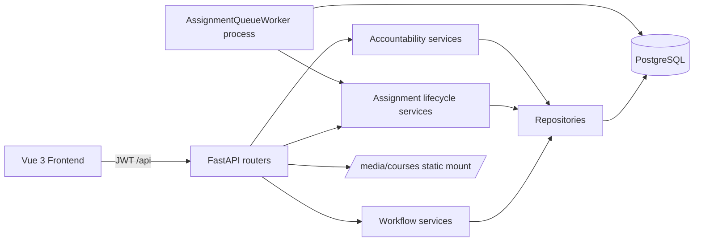
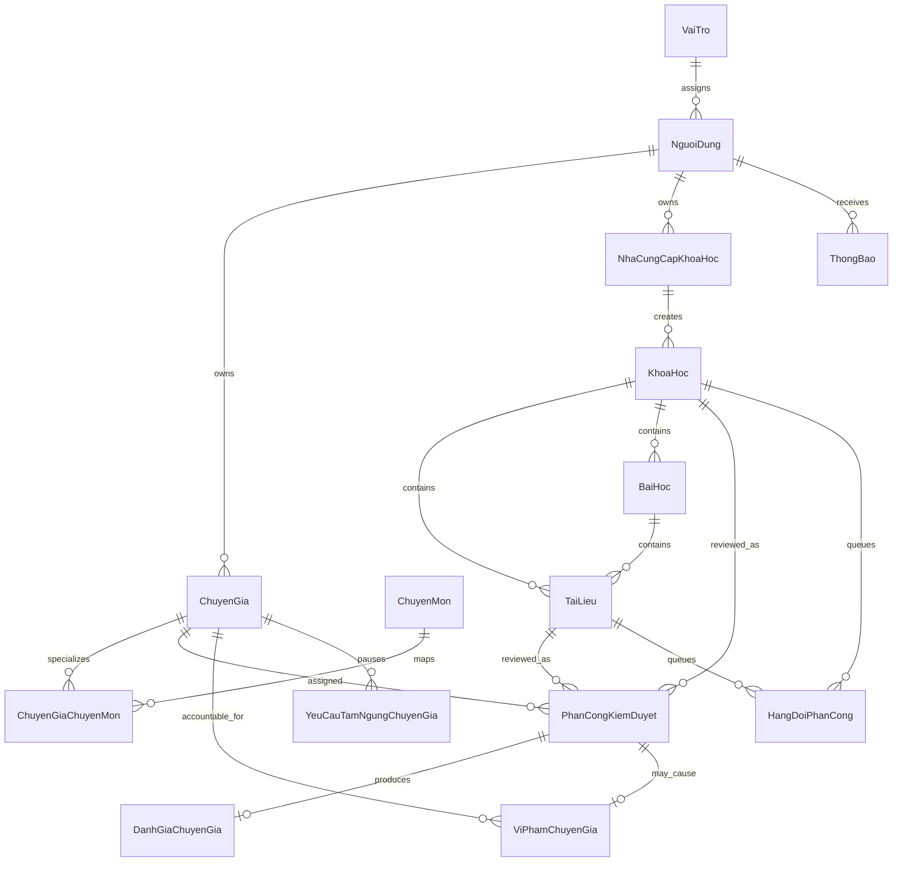
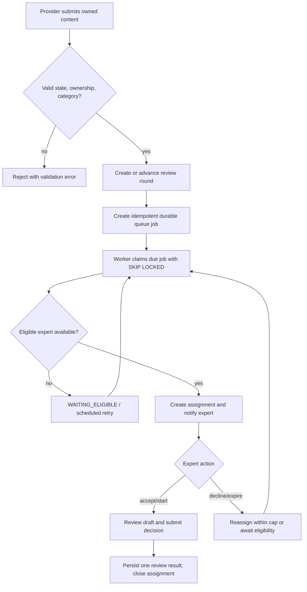
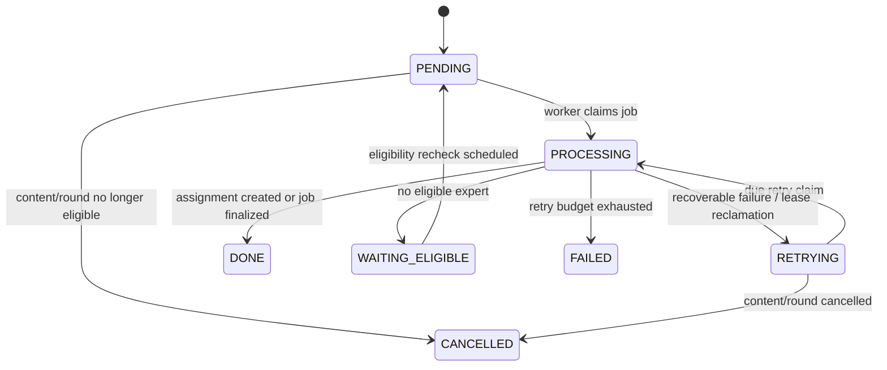
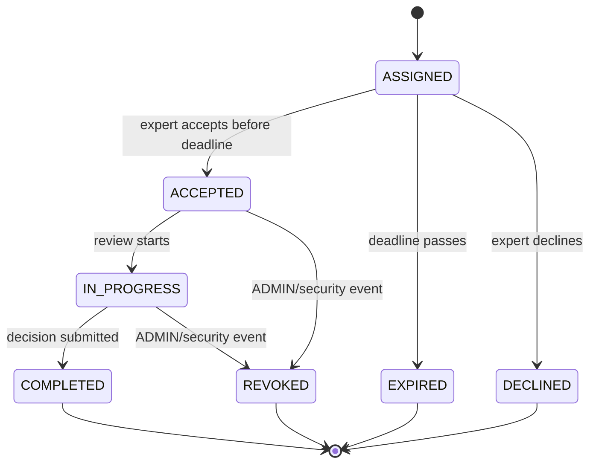

# EduSuggest – Tài liệu kỹ thuật quản lý chuyên gia và phân công kiểm duyệt

**Căn cứ:** source Backend/Frontend hiện tại và báo cáo các giai đoạn GĐ3.0–GĐ3.8. Mọi mục mô tả runtime phải được hiểu trong phạm vi test PostgreSQL `EduSuggest_phase3_test`; Production chưa kích hoạt workflow mới.

## 1. Kiến trúc tổng thể



- Frontend chia theo role ADMIN, EXPERT/Reviewer, PROVIDER và USER; router/ẩn điều khiển hiển thị, authorization bắt buộc nằm ở Backend.
- Backend là FastAPI, SQLAlchemy ORM và repository/service layering. Auth dùng JWT, blacklist/revocation và password hashing hiện có.
- PostgreSQL chứa nghiệp vụ, review round, queue durable, assignments, kết quả, availability, notifications và accountability.
- Worker là class service độc lập với HTTP lifespan. Source hiện không khởi chạy worker tự động và chưa có entrypoint CLI/service dùng `AUTO_ASSIGNMENT_WORKER_ENABLED`; deployment runner cần hoàn thiện/được xác minh trước vận hành.

## 2. Bảng nghiệp vụ và ERD

Các bảng chính (tên model/table theo code):

| Nhóm | Bảng | Mục đích / liên kết |
|---|---|---|
| Danh tính | `NguoiDung`, `VaiTro` | Account, role, trạng thái, force-password-change. Chuyên gia phải có role EXPERT. |
| Hồ sơ | `ChuyenGia`, `ChuyenMon`, `ChuyenGiaChuyenMon` | Hồ sơ chuyên môn, trạng thái xác minh, mapping chuyên môn chính/phụ. |
| Nội dung | `KhoaHoc`, `TaiLieu`, `DanhMuc`, `BaiHoc`, `NhaCungCapKhoaHoc` | Nội dung cần review; tài liệu có thể độc lập hoặc gắn bài học/khóa học. |
| Review | `PhanCongKiemDuyet`, `DanhGiaChuyenGia` | Assignment theo chuyên gia và decision/evaluation; đánh giá liên kết assignment. |
| Queue | `HangDoiPhanCong` | Durable job theo target/review event, idempotency, retry, lease, claim token và generation. |
| Accountability | `ViPhamChuyenGia`, `NhatKyKyLuatChuyenGia`, policy/config | Vi phạm theo assignment, chu kỳ, cảnh báo/khóa và lịch sử hành động ADMIN. |
| Availability | `YeuCauTamNgungChuyenGia` | Yêu cầu pause/approval/revoke và loại chuyên gia khỏi eligibility trong thời gian áp dụng. |
| Notification | `ThongBao` và khóa sự kiện | Nhận thông báo theo chủ sở hữu; event key giúp chống duplicate. |



**Database verified:** production and staging are at Alembic revision `c3d4e5f6a7b8`; no migration ran in GĐ3.8. Production DB was read-only inspected. Stage DB schema is shared revision, so isolated test data belongs only to `EduSuggest_phase3_test`.

## 3. Use cases

| Role | Use cases | Server enforcement |
|---|---|---|
| ADMIN | Create/manage expert, verify profile, handle availability, inspect queue/assignment/accountability, assign manually in exception cases, confirm/exempt/unlock per policy | ADMIN route dependency and service validation; unlock requires reason; expert review decision is not an ADMIN action. |
| EXPERT | First-login password change; complete profile/specialties; request verification; receive/accept/decline assignment; work draft; submit review decision; request pause; read notifications/accountability | Central verified-expert guard and assignment ownership guard; profile must be VERIFIED, account ACTIVE, and assignment must belong to current expert. |
| PROVIDER | Create/manage owned content and submit/resubmit for review | Ownership checks at service/API; submit creates round/queue in enabled workflow. |
| USER | Public eligible content, learning and recommendations | USER role/auth and content visibility gates; no self-upgrade to EXPERT. |

### Activity: content submission and assignment



### Sequence: submit, queue, assignment and review

```mermaid
sequenceDiagram
  participant Provider
  participant API as FastAPI
  participant Service
  participant DB as PostgreSQL
  participant Worker
  participant Expert
  Provider->>API: Submit content (JWT)
  API->>Service: Validate role, ownership and state
  Service->>DB: Update review round + upsert queue event transactionally
  Worker->>DB: Claim due job FOR UPDATE SKIP LOCKED
  Worker->>Service: Rank candidates and assign
  Service->>DB: Validate lease/fence; insert assignment; update job; notify
  Expert->>API: Accept / start / save draft / decision
  API->>Service: Verify expert, assignment owner, target and current round
  Service->>DB: Lock target and assignment; persist state and review evidence
  Service-->>Expert: Current assignment/review state
```

### State models





Availability requests have a request/approval/rejection/revocation lifecycle; approved pause intervals exclude experts from new assignments without silently changing existing review evidence. Exact state transitions are enforced by current services/schemas.

## 4. Assignment scoring, fairness and eligibility

Source module: `backend/service/assignment_scoring.py`, scoring version `3.2.0`. Decimal arithmetic, two decimal places, bounded 0–100:

```text
Total = Specialty + Workload + Experience + Fairness
Specialty  = 50 (primary) or 35 (secondary), never stacked
Workload   = 30 × max(0, 1 − activeAssignments / maxAssignments)
Experience = min(max(yearsExperience, 0), 10)
Fairness   = 10 if never assigned; otherwise 10 × clamp(hoursSinceLastAssignment / 168, 0, 1)
```

Maximum component sum is 100. Candidate eligibility additionally requires EXPERT role, ACTIVE account, changed temporary password, VERIFIED profile, active/matching specialty, no conflict of interest, active workload below configured maximum and no approved pause. Round exclusions also apply. If `uuTienTuyetDoiChuyenMonChinh` is enabled, primary-specialty priority changes ranking as implemented by assignment services; it is a configuration option, not an extra score term.

Capacity is counted from active assignment states under database locks; code defaults and phase reports describe a 1:1 course/independent-material load unit and configured maximum. No eligible candidate leaves job in waiting state for later reevaluation, rather than creating an open-pool assignment.

## 5. Rolling window, discipline, unlock and worker fencing

- Accountability uses a configurable rolling interval (current documented policy 168 hours), warning threshold 2 and lock threshold 4 by default. Counts depend on valid confirmed events and cycle; `REJECTED`/`NEEDS_REVISION` review decisions are not themselves misconduct.
- Violation event stores policy snapshot so late processing uses event-time thresholds. Cycle resolution is explicit across multiple ADMIN unlocks; late events must not be silently assigned to an incorrect cycle.
- At lock threshold, account/token access and active assignments are revoked through service transactions. ADMIN may confirm/exempt/unlock with required action/reason; unlock begins a new discipline cycle, does not restore old JWTs, and does not automatically resume prior assignments.
- Recovery service reconciles durable accountability events after crash. Audit history is retained; cleanup must preserve violation/audit dependencies.
- Worker claims jobs with `FOR UPDATE SKIP LOCKED`; fencing validates worker ID, claim token, lease generation and unexpired lease before execution and before commit. Stale processing jobs are reclaimed, retry uses bounded exponential delays (5/15/30/60s), default lease 60s, batch size 10, poll constant 5s. Worker module defines methods but current app lifespan does not launch a daemon/CLI process.
- ARCH-05 lock discipline in code coordinates target, user, expert, assignment and queue locks across workflow paths. Concurrency tests cover selected conflicting pairs; a full production-like soak with crashes/network partitions was not performed.

## 6. API and authorization overview

Routers are registered in `backend/main.py`: `api.auth`, `api.users`, `api.workflows`, `api.assignments`, `api.accountability`, `api.availability_notifications`, and `api.recommendations`. OpenAPI is the definitive endpoint contract for this revision; this document intentionally does not duplicate every request schema.

Key families:

- `/api/auth/*`: sign-in, current user and session/token lifecycle.
- `/api/provider/*`: owned course/lesson/material management and submissions.
- `/api/expert/*` / reviewer APIs: profile, verification request, assigned work, lifecycle, draft, decision and history.
- `/api/admin/*`: accounts/expert verification, queue/assignment exception controls, availability, accountability and dashboards.
- `/api/notifications/*`: user-owned notification list/read actions.
- `/api/recommendations/*`: separate USER recommendation APIs; no recommendation algorithm changes in GĐ3.8.

Security checks are server-side. Frontend route guards and button visibility are defense-in-depth only. Public course media is mounted at `/media/courses`; `TaiLieu.duongDanTep` is a string/URL field. There is no general authenticated file proxy that can revoke external file URLs. Treat the private-file acceptance case as open until storage and file authorization are explicitly defined and tested.

## 7. Production legacy cases

Read-only audit on 2026-11-26, database `EduSuggest`, Alembic `c3d4e5f6a7b8`:

| Record | Current facts | Safe handling proposal |
|---|---|---|
| Course #28 | PENDING, HIDDEN, review round 0 | Preserve; rehearse idempotent round/job creation on test clone. Never expose or manually assign in production without approved runbook. |
| Material #132 | Independent; no category; PENDING, HIDDEN, round 0 | Do not fabricate category. Resolve through owner/admin data correction process before workflow submission. |
| Expert #4 | User account role USER; profile DRAFT | Preserve role/data. Require application/onboarding and authorized verification; no automatic role migration. |
| Pending course with round 0 | Count 1 | Plan idempotent review-round creation only after test rehearsal and approval. |
| Unverified expert profiles | Count 7 | Count alone does not indicate eligible capacity. Verify ACTIVE account, password, specialty mapping, workload, availability and ownership conflict. |
| Review history | 20 rows in `DanhGiaChuyenGia` | Preserve all history and compare references in a read-only rehearsal. |

## 8. Verification record and limitations

- Full Backend tests: **209 passed**, one Starlette/httpx deprecation warning, flags off.
- Flag-on Phase 3.3–3.8 subset: **28 passed**, one same warning.
- Frontend `npm.cmd run build`: **PASS**, Vite 8.3.8, 1,896 modules.
- Direct staging HTTP: root, health, docs and OpenAPI 200; authenticated endpoints without token return 401.
- Browser/E2E/screenshots, responsive viewport measurements, real worker runner, production flag process environment, real expert capacity and external private-file revocation: **NOT TESTED**.
- No production writes, migration, `.env` edit, Git operation, or Recommendation Engine change in GĐ3.8.

## 9. Giai đoạn kế tiếp

1. Provide a supervised worker entrypoint with explicit DB name assertion, flag gating, graceful stop, heartbeat, metrics and documented launch/rollback. Test it against only `EduSuggest_phase3_test` with concurrent workers and process termination.
2. Decide and implement (after separate approval) private file storage and authorization/revocation semantics; migrate no production data until backup and access plan are reviewed.
3. Run browser E2E in a supported Chrome/Playwright environment: ADMIN expert setup, EXPERT onboarding/review, USER and PROVIDER regression, console/network, keyboard and 375/768/1024/1440 screenshots.
4. Rehearse legacy records and real-expert capacity on a protected test clone; preserve audit/history and prove idempotency.
5. Re-run full acceptance, backup/restore drill and phased production rollout checklist from `EDUSUGGEST_PHASE3_FINAL_ACCEPTANCE_REPORT.md`.

**Trạng thái cuối GĐ3.8:** test/code acceptance **PARTIAL**; Production **NO-GO**, chờ khắc phục blocker và phê duyệt tiếp.
