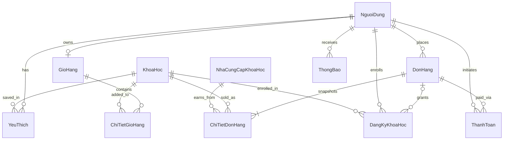
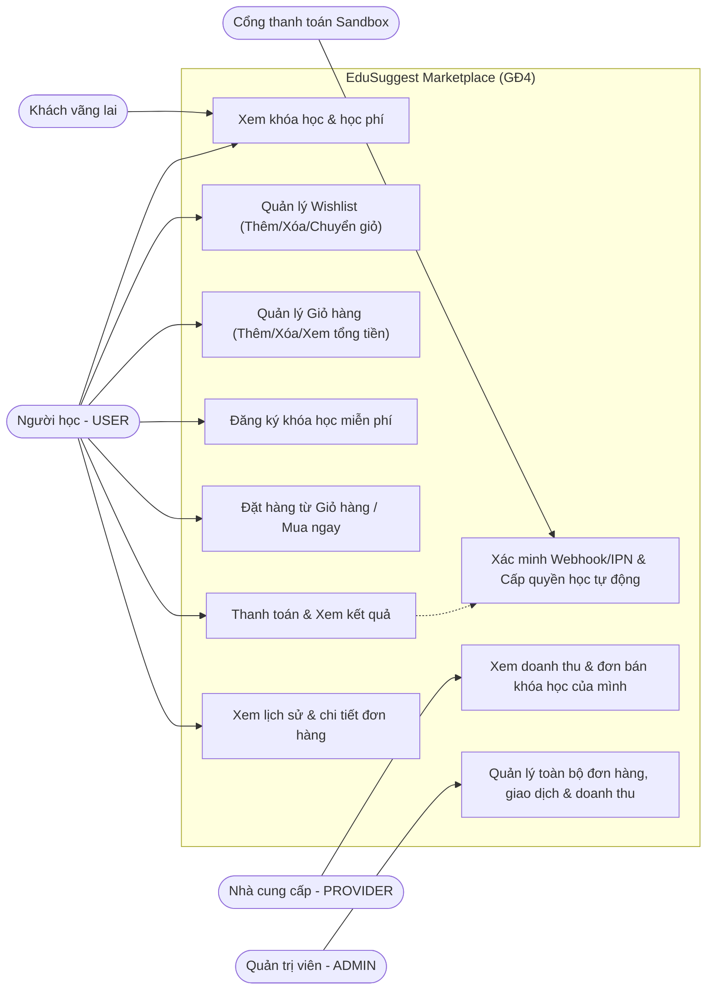
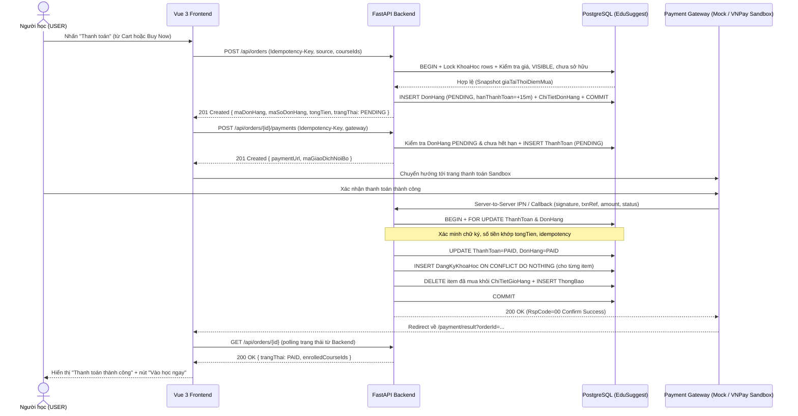
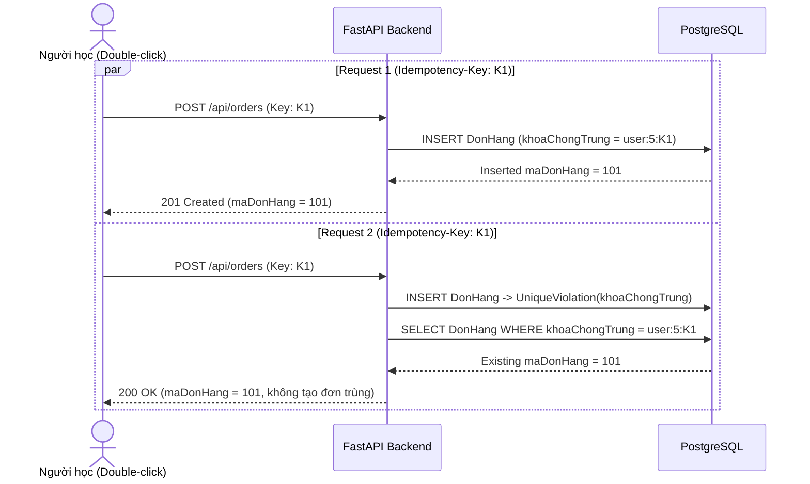
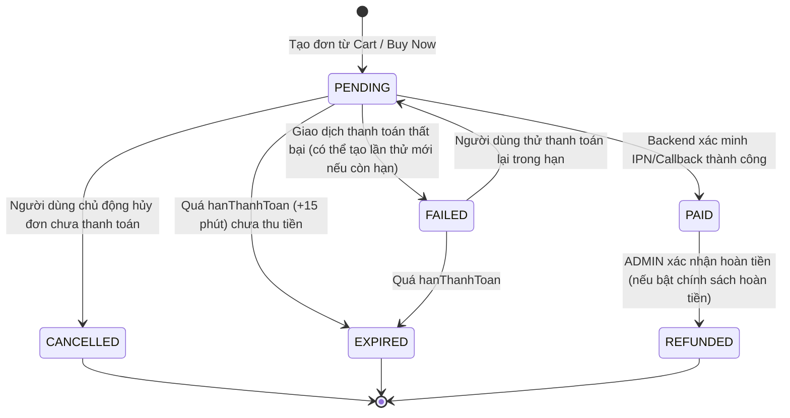
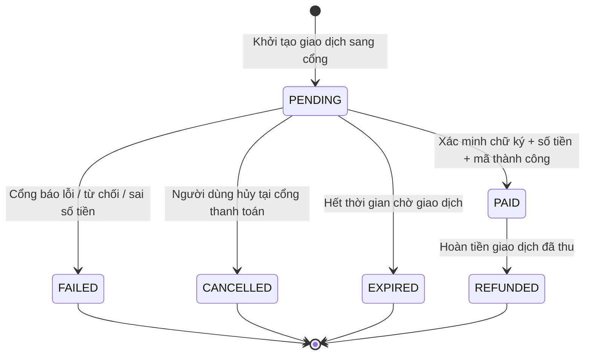

# EDUSUGGEST – GĐ4.0: E-LEARNING MARKETPLACE ARCHITECTURE & COMMERCE DESIGN

**Ngày lập báo cáo:** 2026-11-26  
**Phạm vi:** Kiểm toán hiện trạng (READ ONLY) & Thiết kế kiến trúc thương mại điện tử (E-Learning Marketplace) cho dự án EduSuggest (`D:\đồ án\EduSuggest`)  
**Trạng thái:** **CHỜ PHÊ DUYỆT KIẾN TRÚC — CHƯA TRIỂN KHAI CODE, SCHEMA HAY MIGRATION**

---

## 1. Kiểm toán hiện trạng hệ thống (System Audit — READ ONLY)

Toàn bộ kiểm toán database được thực hiện qua giao dịch `READ ONLY` trên PostgreSQL 16 (`EduSuggest`), kết hợp đọc trực tiếp mã nguồn Backend (FastAPI + SQLAlchemy) và Frontend (Vue 3 + Tailwind CSS). Không có bất kỳ thao tác ghi dữ liệu, thay đổi schema, migration hay chỉnh sửa `.env` nào được thực hiện.

### 1.1. Hiện trạng Database chính `EduSuggest` (`edusuggest-official-v1`)

| Hạng mục | Giá trị kiểm kê thực tế (READ ONLY) | Ghi chú kiến trúc cho GĐ4 |
|---|---|---|
| Database & Alembic head | `EduSuggest` · Revision `c3d4e5f6a7b8` (1 head duy nhất) | Sẵn sàng nối chuỗi migration tuyến tính |
| Tổng số bảng hiện có | **24 bảng** (gồm `alembic_version`) | Chưa có bảng thương mại (Cart/Wishlist/Order/Payment) |
| Tổng số khóa học (`KhoaHoc`) | **120 khóa học** (`24` danh mục, `411` bài học, `243` tài liệu) | 101 `APPROVED + VISIBLE` (82 có phí, 19 miễn phí) |
| Phân bố trạng thái `KhoaHoc` | `APPROVED/VISIBLE`: 101 · `PENDING/HIDDEN`: 8 · `NEEDS_REVISION/HIDDEN`: 4 · `REJECTED/HIDDEN`: 6 · `NULL/HIDDEN`: 1 | 19 khóa học không công khai không được phép mua |
| Trường học phí `KhoaHoc.gia` | Kiểu `numeric` (không giới hạn precision/scale), `nullable=YES`, **không có `CHECK (gia >= 0)`** | **97** khóa có phí (`199.000 ₫` – `899.000 ₫`, TB `~493.845 ₫`), **22** khóa miễn phí (`0 ₫`), **1** khóa `gia IS NULL`, **0** khóa giá âm |
| Tài khoản (`NguoiDung`) | **78 tài khoản** (`ADMIN`: 1, `EXPERT`: 19, `PROVIDER`: 8, `USER`: 50) — 100% `ACTIVE` | Đã có cột `trangThai` (`ACTIVE`/`LOCKED`) và `batBuocDoiMatKhau` |
| Đăng ký (`DangKyKhoaHoc`) | **150 bản ghi** (**117** lượt trên khóa có phí, **33** lượt trên khóa miễn phí), **0** cặp trùng `(maNguoiDung, maKhoaHoc)` | **Chưa có `UNIQUE (maNguoiDung, maKhoaHoc)` ở tầng DB**; `maNguoiDung` và `maKhoaHoc` đang `nullable=YES` |
| Lịch sử học tập (`LichSuHocTap`) | **300 bản ghi** | Phụ thuộc hoàn toàn vào quyền sở hữu khóa học |
| Thông báo (`ThongBao`) | **12 bản ghi**, đã có `loaiThongBao`, `duLieuLienKet (JSONB)`, `khoaChongTrung (UNIQUE)` | Tái sử dụng trực tiếp cho thông báo đơn hàng / thanh toán |

### 1.2. Phát hiện trọng yếu về bảo mật & nghiệp vụ (Audit Findings)

1. **[CRITICAL — COM-01] Lỗ hổng đăng ký trực tiếp khóa học trả phí không cần thanh toán:**
   - Tại `backend/service/workflow_service.py` (`enroll_user_in_course`, dòng 1576–1599) và `backend/api/workflows.py` (`POST /api/courses/{course_id}/enrollments`): hệ thống chỉ kiểm tra khóa học `APPROVED + VISIBLE` và chưa tồn tại `DangKyKhoaHoc`, **hoàn toàn không kiểm tra `course.gia > 0`**.
   - Bất kỳ `USER` nào hiện tại đều có thể gọi trực tiếp API này cho 82 khóa học trả phí công khai để lấy toàn bộ quyền xem bài giảng và tải tài liệu private mà không trả phí.
   - **Yêu cầu bắt buộc ở GĐ4.1–GĐ4.2:** Chặn tuyệt đối `POST /api/courses/{course_id}/enrollments` nếu `course.gia IS NULL` hoặc `course.gia > 0` (trả về `402 Payment Required` hoặc `400 Bad Request` kèm hướng dẫn thanh toán); endpoint này chỉ cấp quyền trực tiếp cho khóa miễn phí (`gia == 0`).
2. **[HIGH — COM-02] Thiếu `UNIQUE` constraint ở tầng DB trên `DangKyKhoaHoc(maNguoiDung, maKhoaHoc)`:**
   - Hiện tại chỉ bảo vệ bằng `pg_advisory_xact_lock(user_id, course_id)` trong `workflow_service.py`. Khi bổ sung luồng Payment Callback/Webhook và Checkout đồng thời, cần bổ sung `UNIQUE (maNguoiDung, maKhoaHoc)` ở tầng PostgreSQL (sau khi xác minh `0` trùng lặp — hiện đã xác nhận `0` trùng) để đảm bảo idempotency tuyệt đối ở mức cơ sở dữ liệu.
3. **[HIGH — COM-03] Khóa học `gia IS NULL` và thiếu `CHECK (gia >= 0)`:**
   - Hiện có 1 bản ghi khóa học `gia IS NULL` (ở trạng thái `HIDDEN`). Khi thương mại hóa, khóa có `gia IS NULL` phải bị từ chối thêm vào giỏ hàng, từ chối mua và từ chối đăng ký miễn phí (fail-closed) cho đến khi Provider cập nhật học phí hợp lệ (`>= 0`).
4. **[MEDIUM — COM-04] Bảo toàn 117 lượt đăng ký khóa trả phí có sẵn (Legacy Grandfathering):**
   - Bộ dữ liệu chính thức `edusuggest-official-v1` có 150 lượt đăng ký (117 lượt thuộc khóa `gia > 0`). Toàn bộ 150 bản ghi này đại diện cho quyền học hợp lệ trước GĐ4 và **không được yêu cầu thanh toán lại**.
5. **[INFO — COM-05] Kiến trúc hiện có đã sẵn sàng mở rộng:**
   - **Auth/RBAC (`backend/api/dependencies.py`)**: Đã kiểm tra `trangThai == "LOCKED"` (trả `403`), JWT blacklist (`TokenBiThuHoi`), `batBuocDoiMatKhau`, và `require_roles(...)`.
   - **Private Material Access (`backend/service/private_material_service.py`)**: Đã kiểm tra `DangKyKhoaHoc` cho `USER` trước khi trả file private. Do đó khi GĐ4 cấp `DangKyKhoaHoc` sau thanh toán thành công, quyền tải tài liệu tự động đồng bộ mà không cần sửa cơ chế lưu trữ file.
   - **Recommendation Engine (`backend/service/recommendation_service.py`)**: Dùng TF-IDF + Cosine Similarity dựa trên `DangKyKhoaHoc` + `LichSuHocTap`, tự động loại `enrolled_ids` khỏi gợi ý.
   - **Frontend**: `UserHeader.vue` (2 tầng), `CourseCard.vue`, `CourseDetail.vue` (hiện chỉ có 1 nút *"Đăng ký khóa học này"*), `UserDashboard.vue`, `AdminDashboard.vue`, `ProviderDashboard.vue` đều dùng chung hệ thống token Editorial EdTech Modernism + Bento Grid.

---

## 2. Phạm vi chức năng mới (Phase 4 Marketplace Scope)

| Phân hệ | Vai trò | Chức năng cốt lõi |
|---|---|---|
| **Wishlist (Yêu thích)** | `USER` | Thêm/xóa khóa học yêu thích (toggle idempotent), xem danh sách yêu thích, chuyển nhanh 1 chạm vào giỏ hàng, lưu bền vững trên DB. |
| **Shopping Cart (Giỏ hàng)** | `USER` | Mỗi USER có 1 giỏ hàng riêng; thêm/xóa khóa học, tự động hiển thị trạng thái nếu khóa học thay đổi giá/ẩn/đã sở hữu; tính tổng tiền từ Backend; hỗ trợ **Mua ngay (Buy Now)**. |
| **Order & Checkout** | `USER` | Tạo đơn hàng từ Giỏ hàng hoặc Mua ngay; chụp snapshot giá (`giaTaiThoiDiemMua`) & thông tin khóa học; hỗ trợ `Idempotency-Key`; kiểm tra lại giá & trạng thái trước khi tạo giao dịch thanh toán. |
| **Payment (Thanh toán)** | `USER`, System | GĐ4.3: **Mock Payment Gateway** phục vụ kiểm thử nội bộ; GĐ4.5: **VNPay Sandbox** (không thu tiền thật); xác minh chữ ký HMAC-SHA512, số tiền, mã giao dịch và idempotency ở Backend IPN/Webhook. |
| **Order History & Detail** | `USER` | Xem lịch sử đơn hàng, trạng thái thanh toán, chi tiết từng khóa học trong đơn, tải/xem hóa đơn điện tử nội bộ, thanh toán lại đơn `PENDING` còn hạn. |
| **ADMIN Commerce** | `ADMIN` | Quản lý toàn bộ đơn hàng & giao dịch thanh toán, tra cứu đối soát, hủy đơn hết hạn, xử lý trạng thái hoàn tiền (nếu bật), Dashboard doanh thu tổng (Gross/Net/Refunded/Provider Share ước tính). |
| **PROVIDER Sales** | `PROVIDER` | Xem danh sách đơn bán & doanh thu **chỉ thuộc khóa học do mình sở hữu**; tách bạch *Doanh thu ghi nhận (Recognized)*, *Hoàn tiền (Refunded)* và *Số dư chờ đối soát (Unsettled — chưa chi trả thật)*. |

---

## 3. Quy tắc nghiệp vụ chi tiết (Business Rules)

### 3.1. Wishlist (`YeuThich`)
- **BR-W01:** Chỉ tài khoản vai trò `USER` đang `ACTIVE` được sử dụng Wishlist.
- **BR-W02:** Một `(maNguoiDung, maKhoaHoc)` chỉ tồn tại tối đa **1 bản ghi** (`UNIQUE`). Thêm khóa đã có trong Wishlist trả về trạng thái idempotent (`200 OK` hoặc `409` thống nhất — đề xuất `200 OK` với `inWishlist: true` cho thao tác toggle/add).
- **BR-W03:** Chỉ cho phép thêm khóa học đang `APPROVED + VISIBLE`. Nếu khóa học sau đó bị ẩn (`HIDDEN`), Wishlist vẫn giữ bản ghi nhưng gắn cờ `unavailable: true` và vô hiệu hóa nút *"Thêm vào giỏ"*.
- **BR-W04:** Chuyển từ Wishlist sang Giỏ hàng (*Move to Cart*) thực hiện trong 1 transaction: kiểm tra điều kiện giỏ hàng → thêm vào `ChiTietGioHang` → xóa khỏi `YeuThich` (hoặc giữ tùy cấu hình; mặc định xóa khỏi Wishlist để tránh trùng ý định mua, tương tự Udemy).
- **BR-W05:** Dữ liệu Wishlist lưu trong PostgreSQL, không bị mất khi đăng xuất hoặc đổi thiết bị.

### 3.2. Shopping Cart (`GioHang`, `ChiTietGioHang`)
- **BR-C01:** Mỗi `USER` có duy nhất 1 giỏ hàng (`UNIQUE(maNguoiDung)`), khởi tạo lười (lazy-create) khi lần đầu truy cập/thêm sản phẩm.
- **BR-C02:** Mỗi khóa học chỉ xuất hiện tối đa 1 lần trong giỏ hàng (`UNIQUE(maGioHang, maKhoaHoc)`) — sản phẩm số không có số lượng (`quantity > 1`).
- **BR-C03:** Từ chối thêm vào giỏ hàng nếu:
  1. Khóa học không tồn tại hoặc không ở trạng thái `APPROVED + VISIBLE` (`400/404`).
  2. Khóa học có `gia IS NULL` hoặc `gia <= 0` (`400` — khóa miễn phí phải dùng luồng *"Đăng ký miễn phí"*, không đi qua giỏ hàng).
  3. Người dùng **đã sở hữu** khóa học (đã có `DangKyKhoaHoc`) (`409 Conflict`).
  4. Khóa học đang nằm trong một đơn hàng `PENDING` còn hiệu lực của chính người dùng đó (cảnh báo hoặc điều hướng sang đơn chờ thanh toán để tránh mua trùng).
- **BR-C04:** **Backend là nguồn chân lý duy nhất về giá.** `GET /api/cart` luôn join `KhoaHoc.gia` hiện hành, tính `tongTien` bằng `Decimal` ở Backend, đồng thời phát hiện và đánh dấu các mục `priceChanged` (nếu so với `giaLucThem`) hoặc `unavailable` (nếu khóa bị ẩn/đã sở hữu).
- **BR-C05:** **Mua ngay (Buy Now):** Tạo đơn hàng trực tiếp cho 1 `maKhoaHoc` duy nhất mà **không cần xóa** các khóa học khác đang nằm sẵn trong giỏ hàng của người dùng. Nếu đơn Buy Now thanh toán thành công và khóa học đó cũng đang có trong giỏ hàng, hệ thống tự động gỡ khóa học đó khỏi `ChiTietGioHang`.

### 3.3. Order & Checkout (`DonHang`, `ChiTietDonHang`)
- **BR-O01:** Đơn hàng có thể khởi tạo từ `source = "CART"` (toàn bộ khóa hợp lệ trong giỏ hoặc danh sách `courseIds` được chọn từ giỏ) hoặc `source = "BUY_NOW"` (1 `courseId`).
- **BR-O02:** Trước khi tạo đơn hàng, Backend khóa dòng (`SELECT ... FOR UPDATE`) trên các `KhoaHoc` liên quan và kiểm tra lại: `APPROVED + VISIBLE`, `gia > 0`, chưa tồn tại `DangKyKhoaHoc`, và tài khoản `USER` đang `ACTIVE`.
- **BR-O03:** **Snapshot bất biến:** Lưu `tieuDeSnapshot`, `maNhaCungCapSnapshot`, `giaTaiThoiDiemMua (NUMERIC(12,0))`, `donViTienTe = 'VND'` vào `ChiTietDonHang`. Nếu Provider đổi giá khóa học sau khi đơn đã tạo, đơn hàng vẫn giữ nguyên snapshot giá đã cam kết (trừ trường hợp đơn `PENDING` quá hạn `EXPIRED`).
- **BR-O04:** **Không tin tổng tiền từ Frontend.** Payload tạo đơn KHÔNG nhận `tongTien` hay `gia` từ client (Pydantic `extra="forbid"`). Mọi phép cộng dùng `Decimal` (PostgreSQL `NUMERIC(12,0)` cho VND, không dùng `float`).
- **BR-O05:** **Idempotency:** Yêu cầu header `Idempotency-Key` (UUID v4) khi tạo đơn (`POST /api/orders`) và khi khởi tạo thanh toán (`POST /api/orders/{id}/payments`). Lưu `khoaChongTrung` (`UNIQUE`) trên `DonHang` và `ThanhToan`: nếu request lặp lại cùng user + cùng key trong cửa sổ hợp lệ → trả lại đúng đơn hàng/giao dịch đã tạo thay vì tạo bản ghi thứ hai.
- **BR-O06:** **Thời hạn thanh toán (Order TTL):** Đơn `PENDING` có `hanThanhToan = ngayTao + 15 phút` (cấu hình được). Trước khi khởi tạo thanh toán hoặc xác nhận callback, nếu quá hạn và chưa thu tiền → chuyển `EXPIRED`.
- **BR-O07:** **Kiểm tra lại trước khi thanh toán:** Tại thời điểm gọi `POST /api/orders/{id}/payments`, kiểm tra lại trạng thái `APPROVED + VISIBLE` và chưa sở hữu. Nếu khóa học vừa bị ẩn hoặc giá thay đổi đáng kể trước khi gửi sang cổng thanh toán → từ chối với mã lỗi rõ ràng (`409`) để người dùng xác nhận lại.

### 3.4. Payment (`ThanhToan`)
- **BR-P01:** Hỗ trợ kiến trúc **Payment Provider Adapter** (`MockSandboxProvider` ở GĐ4.3 và `VNPaySandboxProvider` ở GĐ4.5). Không thu tiền thật trong toàn bộ GĐ4.
- **BR-P02:** **Tuyệt đối không cấp quyền học từ Frontend Redirect (`return_url`).** Trang `Payment Result` ở Frontend chỉ hiển thị trạng thái tạm hoặc polling `GET /api/orders/{id}`; quyền học **chỉ** được cấp khi Backend xác minh thành công callback/IPN (hoặc xác nhận giao dịch mô phỏng server-side ở GĐ4.3).
- **BR-P03:** Mọi callback/IPN phải xác minh đủ 5 điều kiện trong 1 database transaction có row-lock (`SELECT ... FOR UPDATE` trên `ThanhToan` và `DonHang`):
  1. Chữ ký điện tử hợp lệ (HMAC-SHA512 cho VNPay; HMAC secret cho Mock).
  2. Tồn tại `maGiaoDichNoiBo` khớp `ThanhToan`.
  3. Số tiền cổng trả về khớp tuyệt đối `DonHang.tongTien` (VND).
  4. Kiểm tra idempotency: nếu `ThanhToan.trangThai == 'PAID'` rồi → trả `200 OK` (mã `"02" Order already confirmed` chuẩn VNPay) mà không cấp quyền hay ghi nhận doanh thu lần 2.
  5. Không cho phép chuyển trạng thái từ `PAID`/`REFUNDED` ngược về `FAILED`/`CANCELLED`.

### 3.5. Enrollment & Bảo toàn dữ liệu cũ
- **BR-E01:** Khóa học miễn phí (`gia == 0`, `APPROVED + VISIBLE`) tiếp tục đăng ký trực tiếp qua `POST /api/courses/{course_id}/enrollments`.
- **BR-E02:** Khóa học trả phí (`gia > 0`) **chỉ** tạo `DangKyKhoaHoc` bên trong cùng transaction xác nhận thanh toán `PAID` (hoặc cơ chế outbox/reconciliation nếu phát sinh sự cố cục bộ), đảm bảo tính nguyên tử (atomic): `ThanhToan=PAID` + `DonHang=PAID` + `INSERT DangKyKhoaHoc ON CONFLICT DO NOTHING` + xóa item khỏi `ChiTietGioHang` + tạo `ThongBao` mua hàng thành công.
- **BR-E03:** Toàn bộ **150 `DangKyKhoaHoc`** (gồm 117 lượt thuộc khóa có phí) và **300 `LichSuHocTap`** hiện có trong `EduSuggest` được bảo toàn 100%, không bị gắn yêu cầu thanh toán lại. Bổ sung cột tùy chọn `maDonHang` (nullable FK tới `DonHang`) trên `DangKyKhoaHoc`: các bản ghi cũ có `maDonHang = NULL` (nguồn `LEGACY` hoặc `FREE`), bản ghi mua mới có `maDonHang = <id>`.

### 3.6. ADMIN & PROVIDER Revenue Governance
- **BR-R01:** `ADMIN` xem toàn bộ đơn hàng, giao dịch, bộ lọc theo trạng thái/thời gian/provider/khóa học, và báo cáo doanh thu toàn hệ thống.
- **BR-R02:** `PROVIDER` chỉ được truy vấn đơn hàng (`ChiTietDonHang` thuộc `DonHang.trangThai IN ('PAID', 'REFUNDED')`) và thống kê doanh thu của **các khóa học có `KhoaHoc.maNhaCungCap == provider.maNhaCungCap`**. Không lộ thông tin mua các khóa học khác trong cùng đơn hàng đa khóa học (multi-item order).
- **BR-R03:** Tách bạch rõ 3 chỉ số tài chính trên cả ADMIN và PROVIDER Dashboard:
  1. **Doanh thu ghi nhận (Gross Recognized Revenue):** Tổng `ChiTietDonHang.giaTaiThoiDiemMua` của các đơn `PAID`.
  2. **Hoàn tiền (Refunded Amount):** Tổng giá trị các đơn `REFUNDED` (nếu có).
  3. **Doanh thu thuần (Net Revenue = Gross − Refunded)** và nhãn minh bạch **"Chưa thực hiện chi trả tự động (Payout chưa kích hoạt)"** — không triển khai hệ thống chia tiền/chuyển khoản thật trong GĐ4.

---

## 4. Thiết kế Database (ERD hiện tại & ERD đề xuất)

### 4.1. Phân loại 24 bảng hiện có (Revision `c3d4e5f6a7b8`)
- **Core Auth & Users (4):** `VaiTro`, `NguoiDung`, `TokenBiThuHoi`, `ThongBao`.
- **Catalog & Content (6):** `DanhMuc`, `NhaCungCapKhoaHoc`, `DonXinNhaCungCap`, `KhoaHoc`, `BaiHoc`, `TaiLieu`.
- **Learning (2):** `DangKyKhoaHoc`, `LichSuHocTap`.
- **Expert & Automatic Assignment (11):** `ChuyenMon`, `ChuyenMonDanhMuc`, `ChuyenGia`, `ChuyenGiaChuyenMon`, `DanhGiaChuyenGia`, `CauHinhPhanCong`, `PhanCongKiemDuyet`, `HangDoiPhanCong`, `ViPhamChuyenGia`, `NhatKyKyLuatChuyenGia`, `YeuCauTamNgungChuyenGia`.
- **System (1):** `alembic_version`.

### 4.2. Đánh giá và chuẩn hóa 6 bảng thương mại mới (+ nâng cấp nhẹ 2 bảng hiện có)

Cả 6 bảng đề xuất (`YeuThich`, `GioHang`, `ChiTietGioHang`, `DonHang`, `ChiTietDonHang`, `ThanhToan`) đều đạt chuẩn hóa **3NF**, tách rõ giỏ hàng tạm thời với đơn hàng bất biến (snapshot), và tách `DonHang` (1) — `ThanhToan` (N) để hỗ trợ thanh toán lại khi lần thử đầu thất bại/hết hạn mà không làm mất lịch sử giao dịch.

#### Bảng 1: `YeuThich` (Wishlist)
| Cột | Kiểu dữ liệu | Ràng buộc | Mô tả |
|---|---|---|---|
| `maYeuThich` | `INTEGER` | `PK`, auto-increment | Khóa chính |
| `maNguoiDung` | `INTEGER` | `NOT NULL`, `FK -> NguoiDung(maNguoiDung) ON DELETE CASCADE` | Chủ sở hữu wishlist |
| `maKhoaHoc` | `INTEGER` | `NOT NULL`, `FK -> KhoaHoc(maKhoaHoc) ON DELETE CASCADE` | Khóa học yêu thích |
| `ngayTao` | `TIMESTAMP` | `NOT NULL`, default UTC now | Thời điểm thêm |
- **Unique:** `uq_YeuThich_user_course (maNguoiDung, maKhoaHoc)`
- **Index:** `ix_YeuThich_maNguoiDung_ngayTao (maNguoiDung, ngayTao DESC)`

#### Bảng 2: `GioHang` (Shopping Cart)
| Cột | Kiểu dữ liệu | Ràng buộc | Mô tả |
|---|---|---|---|
| `maGioHang` | `INTEGER` | `PK`, auto-increment | Khóa chính |
| `maNguoiDung` | `INTEGER` | `NOT NULL`, `UNIQUE`, `FK -> NguoiDung(maNguoiDung) ON DELETE CASCADE` | Mỗi USER 1 giỏ |
| `ngayTao` | `TIMESTAMP` | `NOT NULL`, default UTC now | Thời điểm tạo |
| `ngayCapNhat` | `TIMESTAMP` | `NOT NULL`, default UTC now | Cập nhật gần nhất |

#### Bảng 3: `ChiTietGioHang` (Cart Items)
| Cột | Kiểu dữ liệu | Ràng buộc | Mô tả |
|---|---|---|---|
| `maChiTietGioHang` | `INTEGER` | `PK`, auto-increment | Khóa chính |
| `maGioHang` | `INTEGER` | `NOT NULL`, `FK -> GioHang(maGioHang) ON DELETE CASCADE` | Giỏ hàng cha |
| `maKhoaHoc` | `INTEGER` | `NOT NULL`, `FK -> KhoaHoc(maKhoaHoc) ON DELETE CASCADE` | Khóa học trong giỏ |
| `giaLucThem` | `NUMERIC(12,0)` | `NOT NULL`, `CHECK (giaLucThem > 0)` | Giá tham chiếu lúc thêm (để báo biến động giá; không dùng để thu tiền) |
| `ngayTao` | `TIMESTAMP` | `NOT NULL`, default UTC now | Thời điểm thêm vào giỏ |
- **Unique:** `uq_ChiTietGioHang_cart_course (maGioHang, maKhoaHoc)`
- **Index:** `ix_ChiTietGioHang_maGioHang (maGioHang)`

#### Bảng 4: `DonHang` (Orders)
| Cột | Kiểu dữ liệu | Ràng buộc | Mô tả |
|---|---|---|---|
| `maDonHang` | `INTEGER` | `PK`, auto-increment | Khóa chính nội bộ |
| `maSoDonHang` | `VARCHAR(32)` | `NOT NULL`, `UNIQUE` | Mã đơn hiển thị/đối soát, ví dụ `ORD-20261126-000123` |
| `maNguoiDung` | `INTEGER` | `NOT NULL`, `FK -> NguoiDung(maNguoiDung) ON DELETE RESTRICT` | Người mua (không xóa cứng lịch sử đơn) |
| `nguonTao` | `VARCHAR(20)` | `NOT NULL`, `CHECK (nguonTao IN ('CART','BUY_NOW'))` | Nguồn khởi tạo đơn |
| `tongTien` | `NUMERIC(12,0)` | `NOT NULL`, `CHECK (tongTien > 0)` | Tổng tiền thanh toán (VND, tính từ Backend) |
| `donViTienTe` | `VARCHAR(3)` | `NOT NULL`, default `'VND'`, `CHECK (donViTienTe = 'VND')` | Đơn vị tiền tệ |
| `trangThai` | `VARCHAR(20)` | `NOT NULL`, default `'PENDING'`, `CHECK (trangThai IN ('PENDING','PAID','FAILED','CANCELLED','EXPIRED','REFUNDED'))` | Trạng thái đơn hàng |
| `khoaChongTrung` | `VARCHAR(100)` | `NOT NULL`, `UNIQUE` | Idempotency key (`user:{id}:{clientKey}`) |
| `hanThanhToan` | `TIMESTAMP` | `NOT NULL` | Hạn thanh toán (mặc định +15 phút) |
| `ngayThanhToan` | `TIMESTAMP` | `NULL` | Thời điểm xác nhận `PAID` |
| `ngayHuy` | `TIMESTAMP` | `NULL` | Thời điểm `CANCELLED`/`EXPIRED` |
| `ngayHoanTien` | `TIMESTAMP` | `NULL` | Thời điểm `REFUNDED` |
| `lyDoHuyHoacHoan` | `TEXT` | `NULL` | Lý do hủy / hoàn tiền |
| `ngayTao` | `TIMESTAMP` | `NOT NULL`, default UTC now | Audit created |
| `ngayCapNhat` | `TIMESTAMP` | `NOT NULL`, default UTC now | Audit updated |
- **Indexes:**
  - `ix_DonHang_user_created (maNguoiDung, ngayTao DESC)`
  - `ix_DonHang_status_created (trangThai, ngayTao DESC)`
  - `ix_DonHang_pending_expiry (hanThanhToan) WHERE trangThai = 'PENDING'` (partial index cho job dọn đơn hết hạn)

#### Bảng 5: `ChiTietDonHang` (Order Line Items — Price & Course Snapshot)
| Cột | Kiểu dữ liệu | Ràng buộc | Mô tả |
|---|---|---|---|
| `maChiTietDonHang` | `INTEGER` | `PK`, auto-increment | Khóa chính |
| `maDonHang` | `INTEGER` | `NOT NULL`, `FK -> DonHang(maDonHang) ON DELETE RESTRICT` | Đơn hàng cha |
| `maKhoaHoc` | `INTEGER` | `NOT NULL`, `FK -> KhoaHoc(maKhoaHoc) ON DELETE RESTRICT` | Khóa học được mua |
| `maNhaCungCap` | `INTEGER` | `NOT NULL`, `FK -> NhaCungCapKhoaHoc(maNhaCungCap) ON DELETE RESTRICT` | Snapshot chủ sở hữu khóa học (phục vụ doanh thu Provider) |
| `tieuDeSnapshot` | `VARCHAR(255)` | `NOT NULL` | Tên khóa học tại thời điểm mua |
| `giaTaiThoiDiemMua` | `NUMERIC(12,0)` | `NOT NULL`, `CHECK (giaTaiThoiDiemMua > 0)` | Giá khóa học snapshot (VND) |
| `ngayTao` | `TIMESTAMP` | `NOT NULL`, default UTC now | Audit created |
- **Unique:** `uq_ChiTietDonHang_order_course (maDonHang, maKhoaHoc)`
- **Indexes:**
  - `ix_ChiTietDonHang_provider_created (maNhaCungCap, ngayTao DESC)` (tối ưu Provider Sales Dashboard)
  - `ix_ChiTietDonHang_course (maKhoaHoc)`

#### Bảng 6: `ThanhToan` (Payment Transactions)
| Cột | Kiểu dữ liệu | Ràng buộc | Mô tả |
|---|---|---|---|
| `maThanhToan` | `INTEGER` | `PK`, auto-increment | Khóa chính |
| `maDonHang` | `INTEGER` | `NOT NULL`, `FK -> DonHang(maDonHang) ON DELETE RESTRICT` | Đơn hàng liên kết |
| `maNguoiDung` | `INTEGER` | `NOT NULL`, `FK -> NguoiDung(maNguoiDung) ON DELETE RESTRICT` | Người thanh toán |
| `congThanhToan` | `VARCHAR(30)` | `NOT NULL`, `CHECK (congThanhToan IN ('MOCK_SANDBOX','VNPAY_SANDBOX'))` | Cổng thanh toán |
| `maGiaoDichNoiBo` | `VARCHAR(64)` | `NOT NULL`, `UNIQUE` | `vnp_TxnRef` / mã giao dịch nội bộ gửi sang cổng |
| `maGiaoDichCong` | `VARCHAR(100)` | `NULL`, `UNIQUE` (partial `WHERE maGiaoDichCong IS NOT NULL`) | `vnp_TransactionNo` do cổng cấp |
| `soTien` | `NUMERIC(12,0)` | `NOT NULL`, `CHECK (soTien > 0)` | Số tiền giao dịch (VND) |
| `donViTienTe` | `VARCHAR(3)` | `NOT NULL`, default `'VND'` | VND |
| `trangThai` | `VARCHAR(20)` | `NOT NULL`, default `'PENDING'`, `CHECK (trangThai IN ('PENDING','PAID','FAILED','CANCELLED','EXPIRED','REFUNDED'))` | Trạng thái giao dịch |
| `khoaChongTrung` | `VARCHAR(100)` | `NOT NULL`, `UNIQUE` | Payment init idempotency key |
| `maPhanHoiCong` | `VARCHAR(32)` | `NULL` | `vnp_ResponseCode` (vd: `'00'`, `'24'`) |
| `duLieuPhanHoiAnToan` | `JSONB` | `NULL` | Payload callback đã lọc bỏ dữ liệu nhạy cảm (không chứa số thẻ/CVV/PIN) |
| `daXacMinhChuKy` | `BOOLEAN` | `NOT NULL`, default `false` | Cờ xác nhận chữ ký IPN hợp lệ |
| `ngayThanhToan` | `TIMESTAMP` | `NULL` | Thời điểm hoàn tất |
| `ngayTao` | `TIMESTAMP` | `NOT NULL`, default UTC now | Audit created |
| `ngayCapNhat` | `TIMESTAMP` | `NOT NULL`, default UTC now | Audit updated |
- **Partial Unique Index chống thanh toán kép:** `uq_ThanhToan_one_paid_per_order ON "ThanhToan"(maDonHang) WHERE trangThai = 'PAID'` — bảo đảm ở tầng DB một đơn hàng **không bao giờ** có 2 giao dịch `PAID`.

#### Chuẩn hóa bổ sung trên 2 bảng hiện có (không mất dữ liệu)
1. **`DangKyKhoaHoc`**:
   - Bổ sung `UNIQUE (maNguoiDung, maKhoaHoc)` (`uq_DangKyKhoaHoc_user_course`) sau khi kiểm tra lại `0` trùng.
   - Bổ sung cột `maDonHang INTEGER NULL FK -> DonHang(maDonHang) ON DELETE RESTRICT` (các bản ghi cũ giữ `NULL`, bảo toàn 100% 150 lượt đăng ký hiện có).
2. **`KhoaHoc`**:
   - Bổ sung `CHECK (gia IS NULL OR gia >= 0)` (`ck_KhoaHoc_gia_non_negative`). Giữ `nullable=YES` để không phá vỡ bản ghi draft cũ, nhưng service thương mại từ chối `gia IS NULL`.

### 4.3. Quy tắc xóa & lưu trữ dữ liệu (Deletion & Privacy Policy)
- **Không lưu thông tin nhạy cảm:** Không lưu số thẻ ngân hàng (PAN), ngày hết hạn thẻ, CVV/CVC, mật khẩu ngân hàng, OTP. Chỉ lưu `maGiaoDichNoiBo`, `maGiaoDichCong`, `maPhanHoiCong`, mã ngân hàng ẩn danh nếu cổng trả về (`vnp_BankCode` như `NCB`), và trạng thái đối soát.
- **Không xóa cứng lịch sử tài chính:** `DonHang`, `ChiTietDonHang`, `ThanhToan` đều dùng `ON DELETE RESTRICT` với `NguoiDung`, `KhoaHoc`, `NhaCungCapKhoaHoc`. Ngăn xóa khóa học hoặc tài khoản đã phát sinh giao dịch (khóa học chỉ được chuyển `HIDDEN`, tài khoản chỉ được chuyển `LOCKED`).

### 4.4. ERD đề xuất (Mermaid)

---

## 5. Use Case Diagram (Mermaid)

---

## 6. Sequence Diagrams (Mermaid)

### 6.1. Luồng Checkout → Thanh toán Sandbox → Cấp quyền học nguyên tử (Atomic)

### 6.2. Luồng chống Race Condition & Double-Click (Idempotency)

---

## 7. Order & Payment State Machines

### 7.1. State Machine Đơn hàng (`DonHang.trangThai`)

### 7.2. State Machine Giao dịch (`ThanhToan.trangThai`)

### 7.3. Bảng chuyển trạng thái hợp lệ (State Transition Guards)
- **Từ `PENDING`**: chỉ sang `PAID`, `FAILED`, `CANCELLED`, `EXPIRED`.
- **Từ `PAID`**: **không bao giờ** quay lại `PENDING`, `FAILED`, `CANCELLED` hay `EXPIRED`; chỉ có thể sang `REFUNDED` bởi `ADMIN` kèm lý do bắt buộc (và có quyết định nghiệp vụ rõ về việc có thu hồi `DangKyKhoaHoc` hay không — xem Mục 16).
- **Trường hợp IPN muộn (Late IPN sau `EXPIRED`)**: Nếu giao dịch đã `EXPIRED` cục bộ nhưng cổng thanh toán gửi IPN `00` (đã trừ tiền thực tế trên sandbox), hệ thống **không tự ghi đè im lặng** mà ghi log cảnh báo đối soát (`RECONCILIATION_REQUIRED`) và thông báo cho `ADMIN` xử lý thủ công.

---

## 8. API Contract đề xuất

Tất cả endpoint đều nằm dưới tiền tố `/api`, sử dụng JWT Bearer, xác định `maNguoiDung` hoàn toàn từ token (không nhận `userId` từ client), Pydantic `extra="forbid"`, tiền tệ trả về dạng chuỗi/số nguyên VND không dùng float.

### 8.1. Wishlist & Cart (`USER` only)
| Method | Endpoint | Mô tả |
|---|---|---|
| `GET` | `/api/wishlist` | Lấy danh sách khóa học yêu thích (kèm giá hiện tại, cờ `unavailable`, `enrolled`, `inCart`) |
| `POST` | `/api/wishlist/{course_id}` | Thêm khóa học vào Wishlist (idempotent) |
| `DELETE` | `/api/wishlist/{course_id}` | Xóa khóa học khỏi Wishlist |
| `POST` | `/api/wishlist/{course_id}/move-to-cart` | Chuyển khóa học từ Wishlist vào Giỏ hàng (atomic) |
| `GET` | `/api/cart` | Lấy giỏ hàng của USER hiện tại (giá live từ `KhoaHoc`, tổng tiền, cờ `priceChanged` / `unavailable`) |
| `POST` | `/api/cart/items` | Thêm khóa học `{ "maKhoaHoc": int }` vào giỏ hàng |
| `DELETE` | `/api/cart/items/{course_id}` | Xóa 1 khóa học khỏi giỏ hàng |
| `DELETE` | `/api/cart` | Xóa toàn bộ giỏ hàng |

### 8.2. Orders & Payments (`USER` + Gateway Callback)
| Method | Endpoint | Vai trò | Mô tả |
|---|---|---|---|
| `POST` | `/api/orders` | `USER` | Tạo đơn hàng từ `CART` hoặc `BUY_NOW`. Bắt buộc header `Idempotency-Key`. Không nhận giá từ client. |
| `GET` | `/api/orders` | `USER` | Lịch sử đơn hàng của chính USER (phân trang, lọc theo `trangThai`). |
| `GET` | `/api/orders/{order_id}` | `USER` | Chi tiết đơn hàng (kiểm tra ownership `order.maNguoiDung == current_user`). |
| `POST` | `/api/orders/{order_id}/cancel` | `USER` | Hủy đơn `PENDING` của chính mình. |
| `POST` | `/api/orders/{order_id}/payments` | `USER` | Khởi tạo giao dịch thanh toán (`MOCK_SANDBOX` hoặc `VNPAY_SANDBOX`). Bắt buộc `Idempotency-Key`. Trả `paymentUrl`. |
| `POST` | `/api/payments/mock/{txn_ref}/confirm` | `USER` (chỉ khi `APP_ENV != production` & `MOCK_PAYMENT_ENABLED=True`) | Mô phỏng kết quả thanh toán (SUCCESS / FAILED / CANCELLED) có ký HMAC nội bộ. |
| `GET` | `/api/payments/vnpay/ipn` | Public (IPN, xác minh HMAC-SHA512) | Webhook IPN chuẩn VNPay Sandbox xác nhận giao dịch & cấp quyền học. |
| `GET` | `/api/payments/vnpay/return` | Public (Read-only verify) | Kiểm tra chữ ký redirect để hiển thị kết quả tạm, **không** cấp quyền học nếu IPN chưa chạy (trừ chế độ localhost sandbox có cờ xác minh rõ ràng được phê duyệt). |

### 8.3. ADMIN & PROVIDER Commerce APIs
| Method | Endpoint | Vai trò | Mô tả |
|---|---|---|---|
| `GET` | `/api/admin/orders` | `ADMIN` | Danh sách toàn bộ đơn hàng (lọc `status`, `fromDate`, `toDate`, `providerId`, `q`, phân trang). |
| `GET` | `/api/admin/orders/{order_id}` | `ADMIN` | Chi tiết đơn hàng + lịch sử tất cả lần thử `ThanhToan`. |
| `GET` | `/api/admin/transactions` | `ADMIN` | Danh sách giao dịch thanh toán phục vụ đối soát. |
| `GET` | `/api/admin/revenue/summary` | `ADMIN` | Báo cáo doanh thu tổng: Gross, Refunded, Net, tổng đơn `PAID`, biểu đồ theo ngày/tháng, top khóa học & top provider. |
| `POST` | `/api/admin/orders/{order_id}/refund` | `ADMIN` | Đánh dấu hoàn tiền đơn `PAID` (yêu cầu lý do, ghi audit). |
| `GET` | `/api/provider/sales/summary` | `PROVIDER` | Doanh thu ghi nhận, hoàn tiền, doanh thu thuần và số lượt bán **chỉ của các khóa học thuộc Provider**. |
| `GET` | `/api/provider/sales/items` | `PROVIDER` | Danh sách `ChiTietDonHang` bán ra của Provider (ẩn thông tin khóa học của Provider khác trong cùng đơn). |

---

## 9. Ma trận phân quyền (RBAC & Ownership Matrix)

| Tài nguyên / Hành động | Guest | `USER` | `PROVIDER` | `EXPERT` | `ADMIN` |
|---|:---:|:---:|:---:|:---:|:---:|
| Xem giá khóa học công khai (`APPROVED+VISIBLE`) | ✅ | ✅ | ✅ | ✅ | ✅ |
| Wishlist & Giỏ hàng | ❌ (401) | ✅ (chỉ của mình) | ❌ (403) | ❌ (403) | ❌ (403) |
| Đăng ký khóa học miễn phí (`gia == 0`) | ❌ (401) | ✅ | ❌ (403) | ❌ (403) | ❌ (403) |
| Đăng ký trực tiếp khóa có phí (`gia > 0`) | ❌ | ❌ (**Chặn 402/400**) | ❌ | ❌ | ❌ |
| Tạo đơn hàng, Thanh toán, Xem đơn của mình | ❌ (401) | ✅ (Owner only) | ❌ (403) | ❌ (403) | ❌ (403) |
| Xem chi tiết đơn hàng của người khác | ❌ | ❌ (**403/404 IDOR**) | ❌ | ❌ | ✅ |
| Xem doanh thu & lượt bán khóa học mình sở hữu | ❌ | ❌ | ✅ (Owner only) | ❌ | ✅ |
| Xem doanh thu toàn sàn / Đơn hàng toàn hệ thống | ❌ | ❌ | ❌ (403) | ❌ (403) | ✅ |
| Xác nhận hoàn tiền đơn hàng (`REFUNDED`) | ❌ | ❌ | ❌ (403) | ❌ (403) | ✅ |
| Duyệt nội dung học thuật khóa học | ❌ | ❌ | ❌ | ✅ (Giữ nguyên) | ❌ (Giữ nguyên) |

---

## 10. Thiết kế giao diện (UI/UX Architecture — 12 Màn hình)

Tuân thủ tuyệt đối hệ thống thiết kế hiện tại (**Editorial EdTech Modernism + Bento Grid**; Deep Navy `#112233`, Smart Teal `#0D9488`, Amber `#D97706`, Canvas `#F8FAF9`, Surface `#FFFFFF`, Subtle `#F1F5F4`) cùng bộ nguyên tắc từ 3 Design Skills đã cài đặt:
- **Emil Design Engineering:** Phản hồi nhấn `active:scale-[0.97]`, badge số lượng giỏ hàng/wishlist chuyển động nhẹ không phô trương, popover xuất phát đúng gốc `origin-top-right`, tôn trọng `prefers-reduced-motion`, không dùng `transition-all`.
- **Impeccable Craft Floor:** Tương phản ≥ 4.5:1, số tiền dùng `tabular-nums`, một lớp elevation rõ ràng (viền mảnh hoặc bóng lệch mềm), không gradient chữ, không eyebrow thừa, trạng thái loading/empty/error trung thực.
- **Design Taste Frontend:** Cạnh lề bằng nhau (equal edges), mật độ thông tin thoáng, tối đa 1 hành động chính rõ ràng mỗi thẻ.

### Đặc tả 12 màn hình & thành phần
1. **Header người học (`UserHeader.vue`):** Giữ bố cục 2 tầng (Hàng 1 điều hướng chính; Hàng 2 thanh tìm kiếm ở các trang chưa có thanh tìm kiếm riêng). Bên phải Hàng 1 bổ sung 2 nút icon gọn kích thước `size-9` trước chuông thông báo: **Heart (Wishlist)** và **ShoppingCart (Giỏ hàng)** kèm badge đếm số `tabular-nums` (`bg-teal` cho giỏ hàng, chỉ hiển thị khi `count > 0`).
2. **CourseCard (`CourseCard.vue`):** Giữ sạch, **không nhồi nút "Mua ngay" + "Thêm giỏ hàng" lên thẻ**. Chỉ bổ sung:
   - 1 nút icon **Heart** nhỏ góc trên phải ảnh bìa (glass nhẹ, `aria-pressed`, toggle Wishlist 1 chạm).
   - Footer giữ nguyên bố cục gọn: bên trái hiển thị học phí (`tabular-nums`, ví dụ `499.000 ₫` hoặc `Miễn phí`), bên phải hiển thị trạng thái thông minh (`Đã sở hữu` / `Xem chi tiết`).
3. **CourseDetail (`CourseDetail.vue`):** Cột sticky bên phải phân nhánh rõ theo trạng thái thật từ Backend:
   - *Đã sở hữu:* Nút chính **"Vào phòng học ngay"** (`bg-navy`).
   - *Miễn phí (`gia == 0`):* Nút chính **"Đăng ký học miễn phí"** (`bg-teal`).
   - *Trả phí (`gia > 0`):* Nút chính **"Mua ngay"** (`bg-navy`), nút phụ **"Thêm vào giỏ hàng"** (hoặc *"Đi tới giỏ hàng"* nếu đã có trong giỏ) + nút **Heart (Lưu vào yêu thích)** gọn bên cạnh.
4. **Wishlist (`/wishlist`):** Lưới thẻ khóa học đã lưu; mỗi thẻ có 2 hành động rõ ràng (*"Chuyển vào giỏ hàng"* và *"Bỏ yêu thích"*); hiển thị cảnh báo gọn nếu khóa học vừa bị ẩn hoặc người dùng đã sở hữu.
5. **Shopping Cart (`/cart`):** Bố cục 2 cột Bento (8/4 trên desktop):
   - Trái: Danh sách khóa học trong giỏ (ảnh bìa 16:9, tiêu đề, nhà cung cấp, học phí live từ Backend, badge cảnh báo nếu giá vừa thay đổi hoặc khóa học tạm ẩn, nút *"Xóa"* và *"Lưu vào yêu thích"*).
   - Phải (sticky): Tóm tắt đơn hàng (số lượng khóa học, tổng tiền VND `tabular-nums` in đậm Deep Navy, nút **"Tiến hành thanh toán"**).
6. **Checkout (`/checkout`):** Bố cục 2 cột tập trung (giảm nhiễu điều hướng):
   - Trái: Xác nhận danh sách khóa học snapshot giá + Chọn phương thức thanh toán (*Thanh toán mô phỏng Sandbox* / *VNPay Sandbox*) + ghi chú minh bạch *"Môi trường kiểm thử — không phát sinh giao dịch tiền thật"*.
   - Phải: Tóm tắt đơn hàng, đồng hồ đếm ngược `hanThanhToan` (15 phút), nút **"Xác nhận thanh toán"** (disable ngay khi bấm để chống double-click, gắn `Idempotency-Key`).
7. **Payment Result (`/payment/result`):** Hiển thị trạng thái thật lấy từ `GET /api/orders/{id}` (loading/polling nếu đang chờ IPN → Thành công kèm danh sách nút *"Vào học ngay"* cho từng khóa đã mua → hoặc Thất bại/Hết hạn kèm lý do và nút *"Thử thanh toán lại"*).
8. **Order History (`/orders`):** Bảng/danh sách thẻ đơn hàng theo thời gian, bộ lọc trạng thái (`Tất cả`, `Chờ thanh toán`, `Đã thanh toán`, `Thất bại/Hết hạn`, `Hoàn tiền`), mã đơn `ORD-...`, số khóa học, tổng tiền `tabular-nums`, và thao tác *"Xem chi tiết"* / *"Thanh toán tiếp"* (nếu `PENDING` còn hạn).
9. **Order Detail (`/orders/:id`):** Mã đơn, trạng thái, mốc thời gian thanh toán, phương thức, bảng chi tiết từng khóa học với giá snapshot, và nút *"Vào học"* trực tiếp cho các đơn `PAID`.
10. **ADMIN Order Management (`/admin/orders`):** Bảng dữ liệu mật độ chuẩn quản trị, tìm theo `maSoDonHang` / người mua, lọc trạng thái/ngày/cổng thanh toán, drawer/modal xem chi tiết lịch sử giao dịch `ThanhToan` và nút xử lý hoàn tiền có xác nhận lý do.
11. **ADMIN Revenue Dashboard (`/admin/revenue`):** KPI Ledger (Doanh thu ghi nhận, Hoàn tiền, Doanh thu thuần, Tổng đơn thành công, Giá trị đơn TB), biểu đồ doanh thu theo thời gian (SVG sạch, không dùng thư viện nặng thừa), bảng Top khóa học bán chạy và Top Nhà cung cấp.
12. **PROVIDER Sales Dashboard (`/provider/sales`):** KPI riêng của Provider (Doanh thu ghi nhận từ khóa học của bạn, Lượt bán thành công, Hoàn tiền, Trạng thái đối soát *"Chưa bật chi trả tự động"*), danh sách giao dịch bán từng khóa học của mình kèm bộ lọc theo khóa học & khoảng thời gian.

---

## 11. Phương án thanh toán Sandbox (Không thu tiền thật)

### 11.1. Lộ trình 2 bước an toàn
1. **GĐ4.3 — Mock Payment Sandbox (`MOCK_SANDBOX`):**
   - Hoạt động 100% cục bộ không phụ thuộc internet/bên thứ ba, chỉ bật khi `MOCK_PAYMENT_ENABLED=True` và `APP_ENV != "production"`.
   - Khi tạo thanh toán, Backend trả URL nội bộ `/payment/mock-gateway?txnRef=...&sig=...`. Người dùng chọn 1 trong 3 kịch bản kiểm thử (**Thanh toán thành công**, **Thất bại**, **Hủy giao dịch**), gửi về Backend xác minh chữ ký HMAC nội bộ và kích hoạt cùng luồng xử lý IPN như cổng thật.
2. **GĐ4.5 — VNPay Sandbox (`VNPAY_SANDBOX` — Khuyến nghị ưu tiên hơn MoMo):**
   - **Lý do chọn VNPay Sandbox làm cổng ưu tiên:** Tài liệu kỹ thuật rõ ràng cho đồ án tại Việt Nam, hỗ trợ trực tiếp VND nguyên, ký **HMAC-SHA512** chuẩn trên chuỗi tham số sắp xếp theo bảng chữ cái, có thẻ test NCB công khai, hỗ trợ rõ mô hình **IPN URL (Server-to-Server)** tách biệt **Return URL (Browser Redirect)**, dễ kiểm thử bằng tunnel (ngrok/Cloudflare Tunnel) hoặc giả lập IPN trong pytest.
   - *(So sánh với MoMo Sandbox: MoMo yêu cầu đăng ký partner/app và ứng dụng MoMo Test trên điện thoại di động, phức tạp hơn khi demo bảo vệ đồ án so với VNPay web checkout).*

### 11.2. Cơ chế xác minh VNPay Sandbox IPN
- Kiểm tra `vnp_SecureHash` bằng `hmac.compare_digest` (constant-time) với `VNPAY_HASH_SECRET` lưu trong biến môi trường (chỉ thêm khi được phê duyệt ở GĐ4.5).
- Kiểm tra `vnp_TxnRef` tồn tại trong `ThanhToan`.
- Kiểm tra `int(vnp_Amount) == int(order.tongTien) * 100` (VNPay nhân 100).
- Kiểm tra `ThanhToan.trangThai == 'PENDING'` (nếu đã `PAID` → trả `{"RspCode": "02", "Message": "Order already confirmed"}`).
- Nếu `vnp_ResponseCode == '00'` và `vnp_TransactionStatus == '00'` → cập nhật `PAID` + cấp `DangKyKhoaHoc` nguyên tử + trả `{"RspCode": "00", "Message": "Confirm Success"}`.

---

## 12. Tích hợp với Recommendation Engine (TF-IDF + Cosine Similarity)

- **Giữ nguyên 100% thuật toán và mã nguồn** `backend/service/recommendation_service.py` và `backend/service/content_recommendation.py` trong GĐ4.
- **Loại trừ khóa đã sở hữu:** Cơ chế hiện tại (`excluded_course_ids = enrolled_ids`) tự động loại trừ tất cả khóa học người dùng đã mua thành công (vì thanh toán thành công tạo `DangKyKhoaHoc`).
- **Không coi Wishlist/Cart là đã học:** `YeuThich` và `ChiTietGioHang` **không** được ghi vào `DangKyKhoaHoc` hay `LichSuHocTap`, không làm sai lệch tiến độ học tập hoặc hồ sơ đã hoàn thành.
- **Định hướng mở rộng tương lai (sau GĐ4, cần đánh giá thực nghiệm):** Có thể bổ sung Wishlist làm tín hiệu quan tâm yếu (*weak positive signal*, trọng số đề xuất `0.35`, thấp hơn nhiều so với đăng ký `1.0+` và hoàn thành `2.0+`) cho người dùng cold-start chưa có đăng ký nào, chỉ triển khai khi có bộ kiểm thử đánh giá độ chính xác (Precision@K / NDCG@K) riêng.

---

## 13. Kế hoạch bảo toàn dữ liệu hiện có (Data Preservation Plan)

1. **Sao lưu bắt buộc trước mọi migration:** Tạo `pg_dump --format=custom` kèm file kiểm tra SHA-256 trên `EduSuggest` trước khi chạy bất kỳ migration GĐ4 nào.
2. **Bảo toàn 150 `DangKyKhoaHoc` (gồm 117 lượt khóa trả phí) & 300 `LichSuHocTap`:**
   - Thêm cột `DangKyKhoaHoc.maDonHang` dạng `NULLABLE`, mặc định `NULL` cho toàn bộ 150 bản ghi cũ.
   - Quyền truy cập bài học (`get_user_learning_course`), tài liệu private (`authorize_private_file`) và tiến độ học tập tiếp tục kiểm tra sự tồn tại của `DangKyKhoaHoc` — **không kiểm tra `maDonHang IS NOT NULL`**. Nhờ đó 100% người học cũ vẫn học bình thường và không bị đòi thanh toán lại.
3. **Xử lý 1 khóa học legacy có `gia IS NULL`:** Không tự ý sửa giá dữ liệu cũ; constraint `CHECK (gia IS NULL OR gia >= 0)` cho phép bản ghi cũ tồn tại an toàn, đồng thời tầng service chặn mua/đăng ký với khóa có `gia IS NULL`.
4. **Không chạm các runtime flags GĐ3:** Giữ nguyên `EXPERT_MANAGEMENT_ENABLED`, `AUTO_ASSIGNMENT_WORKFLOW_ENABLED`, `AUTO_ASSIGNMENT_WORKER_ENABLED`, `ACCOUNTABILITY_ENABLED` ở trạng thái hiện tại trên Production.

---

## 14. Migration Plan (Dự kiến cho GĐ4.1 — Chưa thực thi)

- **Alembic chain:** Nối tiếp duy nhất 1 revision mới (`down_revision = 'c3d4e5f6a7b8'`), giữ cấu trúc **single head**.
- **Nội dung migration (dự kiến `d4e5f6a7b8c9_phase4_marketplace_commerce.py`):**
  1. Tạo 6 bảng: `YeuThich`, `GioHang`, `ChiTietGioHang`, `DonHang`, `ChiTietDonHang`, `ThanhToan` cùng đầy đủ PK, FK, CHECK, UNIQUE và Indexes (gồm partial unique index `uq_ThanhToan_one_paid_per_order`).
  2. Thêm `CHECK (gia IS NULL OR gia >= 0)` lên `KhoaHoc`.
  3. Xác minh `0` bản ghi trùng trên `DangKyKhoaHoc(maNguoiDung, maKhoaHoc)` → thêm `UNIQUE (maNguoiDung, maKhoaHoc)` và cột `maDonHang INTEGER NULL FK -> DonHang(maDonHang) ON DELETE RESTRICT`.
- **Rehearsal trước khi lên Production:** Chạy thử `alembic upgrade head` và `alembic downgrade c3d4e5f6a7b8` trên database kiểm thử riêng (`EduSuggest_phase4_test` hoặc staging clone từ snapshot `edusuggest-official-v1`) trước khi áp dụng lên `EduSuggest`.

---

## 15. Security & Concurrency Test Matrix (13 Kịch bản bắt buộc)

| Mã | Kịch bản kiểm thử | Hành vi tấn công / lỗi | Kết quả mong đợi (Pass Criteria) |
|---|---|---|---|
| **SEC-C01** | Cross-user Cart Access | User B gửi request xem/xóa item trong giỏ của User A | Backend chỉ lấy `user_id` từ JWT; không thể truy cập giỏ người khác (`404/403`) |
| **SEC-C02** | IDOR Order / Payment | User B gọi `GET /api/orders/{orderA}`, `POST .../cancel` hoặc `.../payments` | Trả `404` hoặc `403`, không lộ dữ liệu đơn hàng của User A |
| **SEC-C03** | Price Tampering | Client chèn `gia: 1000`, `tongTien: 0` vào body `POST /api/orders` | Pydantic `extra="forbid"` trả `422`; giá luôn tính từ `KhoaHoc.gia` trên DB |
| **SEC-C04** | Duplicate Order | Gửi lặp `POST /api/orders` cùng `Idempotency-Key` | Chỉ tạo 1 `DonHang`; request thứ 2 trả lại đúng đơn đã tạo |
| **SEC-C05** | Duplicate Payment Callback | Gửi lặp IPN/Webhook thành công 2–5 lần cùng `maGiaoDichNoiBo` | Lần 1 chuyển `PAID` + cấp quyền; các lần sau trả `200` idempotent, không nhân đôi doanh thu hay enrollment |
| **SEC-C06** | Double-click Checkout | 2 request đồng thời tạo đơn / khởi tạo thanh toán trong vài mili-giây | Khóa `khoaChongTrung` + `FOR UPDATE` đảm bảo chỉ 1 đơn / 1 giao dịch hợp lệ |
| **SEC-C07** | Concurrent Purchase | 2 luồng song song thanh toán 2 đơn khác nhau chứa cùng 1 khóa học | `uq_DangKyKhoaHoc_user_course` ngăn trùng enrollment; đơn thứ 2 bị chặn trước khi tạo thanh toán nếu khóa đã sở hữu |
| **SEC-C08** | Payment Amount Mismatch | Callback/IPN giả mạo số tiền nhỏ hơn `DonHang.tongTien` | Từ chối xác nhận (`RspCode=04 Invalid amount`), giữ đơn không `PAID`, ghi log cảnh báo |
| **SEC-C09** | Signature Verification | Callback/IPN sai hoặc thiếu `vnp_SecureHash` / HMAC | Từ chối ngay (`RspCode=97 Invalid signature`), không cập nhật DB |
| **SEC-C10** | Unauthorized Enrollment | USER gọi trực tiếp `POST /api/courses/{paid_id}/enrollments` bỏ qua Checkout | Trả `402/400`, **không** tạo `DangKyKhoaHoc` |
| **SEC-C11** | Provider Revenue Ownership | Provider A gọi API doanh thu/đơn bán với `courseId`/`providerId` của Provider B | Chỉ trả dữ liệu thuộc `maNhaCungCap` của Provider A; không lộ item của Provider B trong đơn đa khóa học |
| **SEC-C12** | Course Visibility Changes | Khóa học bị ADMIN ẩn (`HIDDEN`) sau khi đã vào giỏ hoặc tạo đơn `PENDING` | Chặn checkout/khởi tạo thanh toán (`409`); khóa đã `PAID` vẫn giữ lịch sử giao dịch |
| **SEC-C13** | Account Lock During Checkout | Tài khoản USER bị ADMIN khóa (`LOCKED`) ngay trước khi gọi thanh toán | `get_current_principal` chặn ngay `403`; callback thanh toán kiểm tra trạng thái tài khoản trước khi kích hoạt nếu cần |

---

## 16. Lộ trình triển khai GĐ4.1 – GĐ4.7 & Các quyết định cần phê duyệt

### 16.1. Lộ trình triển khai đề xuất
- **GĐ4.1 — Database Migration & Commerce Models:** Tạo 6 bảng thương mại, chuẩn hóa `DangKyKhoaHoc` & `KhoaHoc.gia`, kiểm thử upgrade/downgrade trên DB test riêng.
- **GĐ4.2 — Wishlist, Cart & Free/Paid Enrollment Gate:** Triển khai API Wishlist/Cart, vá lỗ hổng **COM-01** (chặn đăng ký trực tiếp khóa có phí), viết pytest unit & integration.
- **GĐ4.3 — Order, Checkout & Mock Payment Sandbox:** Triển khai `DonHang`, `ChiTietDonHang`, `ThanhToan`, `Idempotency-Key`, Mock Payment Gateway, cấp quyền học nguyên tử + thông báo `ThongBao`, hoàn tất 13 test bảo mật & concurrency.
- **GĐ4.4 — Learner Marketplace UI:** Nâng cấp `UserHeader` (Heart + Cart badges), `CourseCard`, `CourseDetail` và xây dựng 6 màn hình người học (`Wishlist`, `Cart`, `Checkout`, `Payment Result`, `Order History`, `Order Detail`).
- **GĐ4.5 — VNPay Sandbox Integration:** Tích hợp adapter `VNPaySandboxProvider` (HMAC-SHA512, Return URL + IPN Webhook) và kiểm thử toàn trình sandbox.
- **GĐ4.6 — ADMIN & PROVIDER Revenue Dashboards:** Xây dựng API & giao diện `Admin Orders`, `Admin Revenue Dashboard`, `Provider Sales Dashboard`.
- **GĐ4.7 — Final Acceptance, Security Audit & Controlled Staging Verification:** Kiểm thử hồi quy toàn bộ GĐ1–GĐ4, kiểm thử bảo mật/concurrency, kiểm tra responsive trên trình duyệt và nghiệm thu.

### 16.2. Các quyết định nghiệp vụ cần bạn phê duyệt trước khi bắt đầu GĐ4.1

Vui lòng xác nhận 5 điểm dưới đây (có kèm phương án đề xuất mặc định):

1. **Tên & cấu trúc 6 bảng mới + nâng cấp nhẹ `DangKyKhoaHoc`:** Phê duyệt tạo 6 bảng (`YeuThich`, `GioHang`, `ChiTietGioHang`, `DonHang`, `ChiTietDonHang`, `ThanhToan`), thêm `UNIQUE (maNguoiDung, maKhoaHoc)` + `maDonHang (nullable)` trên `DangKyKhoaHoc` và `CHECK (gia IS NULL OR gia >= 0)` trên `KhoaHoc`? *(Đề xuất: Đồng ý)*
2. **Cổng thanh toán Sandbox ưu tiên ở GĐ4.5:** Chọn **VNPay Sandbox** (làm trước Mock Sandbox ở GĐ4.3 để test tự động, sau đó tích hợp VNPay Sandbox ở GĐ4.5)? *(Đề xuất: Đồng ý VNPay Sandbox)*
3. **Chính sách hoàn tiền (`REFUNDED`):** Trong phạm vi đồ án GĐ4, hỗ trợ ADMIN đánh dấu hoàn tiền thủ công kèm lý do và **thu hồi `DangKyKhoaHoc`** hay **giữ trạng thái ghi nhận `REFUNDED` không xóa tiến độ học** (hoặc chưa bật hoàn tiền ở GĐ4.3, chỉ đặt trạng thái sẵn trong schema)? *(Đề xuất: Đặt sẵn trạng thái `REFUNDED` trong schema/state machine; chỉ bật API ADMIN đánh dấu hoàn tiền ở GĐ4.6 kèm tùy chọn thu hồi quyền học)*
4. **Hạn thanh toán đơn `PENDING` (Order TTL):** Đặt mặc định **15 phút** (khớp chuẩn VNPay Sandbox)? *(Đề xuất: 15 phút)*
5. **Tỷ lệ chiết khấu / doanh thu chia sẻ hiển thị cho Provider:** Hiện tại không triển khai payout thật; bạn muốn Provider Sales Dashboard hiển thị **100% doanh thu ghi nhận từ khóa học (Gross/Net Sales)** hay hiển thị thêm ước tính phí nền tảng (ví dụ 80%/20%) chỉ mang tính tham khảo? *(Đề xuất: Hiển thị minh bạch Doanh thu ghi nhận 100% + Hoàn tiền + Doanh thu thuần, không giả lập tỷ lệ chia tiền khi chưa có chính sách payout)*

---
*Kết thúc báo cáo thiết kế kiến trúc GĐ4.0. Hệ thống giữ nguyên trạng thái READ ONLY và dừng tại đây chờ phê duyệt kiến trúc của bạn.*

---

## 11. Cập nhật kiểm toán GĐ4.6: Chính sách hoàn tiền ngoại lệ & Đề xuất Schema trước khi thu tiền thật (2026-11-26)

Sau đợt kiểm toán an toàn thanh toán GĐ4.6 ([EDUSUGGEST_PHASE4_PAYMENT_SAFETY_AUDIT_REPORT.md](EDUSUGGEST_PHASE4_PAYMENT_SAFETY_AUDIT_REPORT.md)), kiến trúc GĐ4.0 được bổ sung 3 nguyên tắc vận hành và 3 đề xuất nâng cấp schema cho giai đoạn thu tiền thật (chưa tạo migration tự động):

1. **Chính sách hoàn tiền ngoại lệ (Exception Refund Only):**
   - Không cung cấp nút hoàn tiền thông thường cho `USER`; `USER` chỉ được gửi *"Báo cáo sự cố thanh toán"* trên đơn hàng của chính mình.
   - `ADMIN` ưu tiên **Khôi phục quyền học (`Priority #1`)** nếu giao dịch đã thu tiền hợp lệ và khóa học còn khả dụng; chỉ hoàn tiền ngoại lệ khi sự cố đã xác minh (`EXCESS_PAYMENT` giữ nguyên quyền học `ACTIVE` & doanh thu đơn hợp lệ; `FULL_ORDER` thu hồi duy nhất quyền học của `maDonHang` thành `REVOKED` và bảo toàn `LichSuHocTap` + `LEGACY`).
2. **Không bao giờ đánh mất bằng chứng thu tiền trùng:**
   - Do `uq_ThanhToan_one_paid_per_order` chỉ cho phép 1 dòng `ThanhToan.trangThai = 'PAID'` trên mỗi đơn, mọi giao dịch thu trùng/IPN trễ đều được bảo toàn bằng chứng (`fundsCaptured=true`, `capturedAmountVnd`, `maGiaoDichCong`, `auditTrail`) trong `ThanhToan.duLieuPhanHoiAnToan` dưới khóa hàng `FOR UPDATE`.
3. **Đề xuất Migration cho giai đoạn thu tiền thật (chờ phê duyệt trước khi triển khai):**
   - Bổ sung trạng thái `'CAPTURED_UNAPPLIED'` vào `CHECK` của `ThanhToan.trangThai`.
   - Tách bảng quan hệ `HoanTienNgoaiLe` (có `UNIQUE` ở tầng DB cho `khoaChongTrung` và chỉ mục chống mở 2 yêu cầu hoàn tiền song song trên cùng `maThanhToan`).
   - Tách bảng quan hệ `BaoCaoSuCoThanhToan` để quản trị SLA sự cố người dùng độc lập với payload giao dịch.
